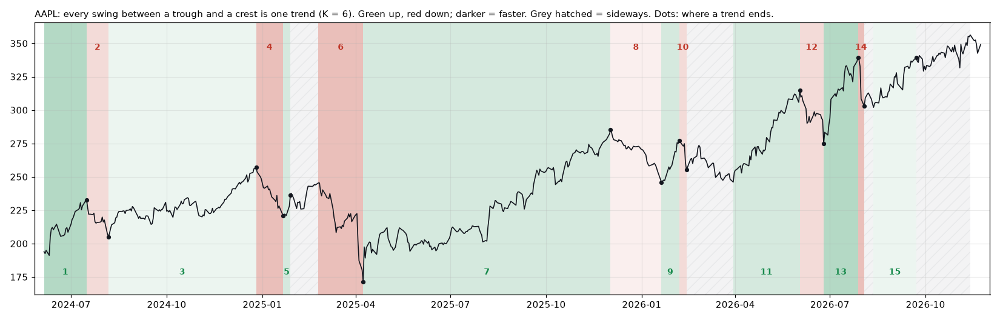
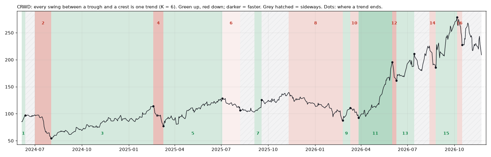
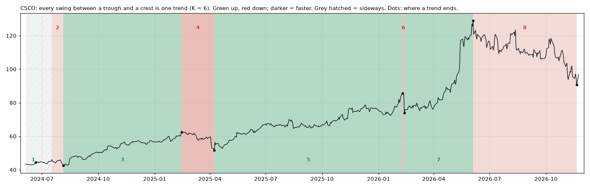
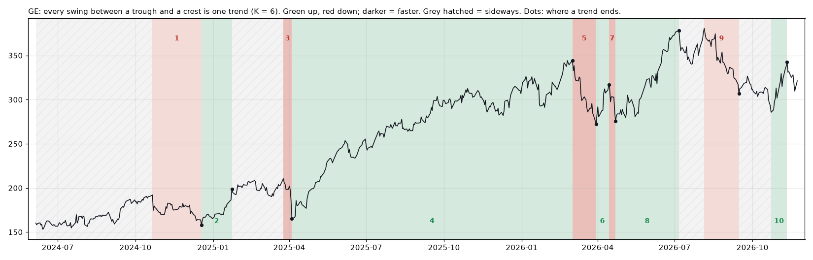
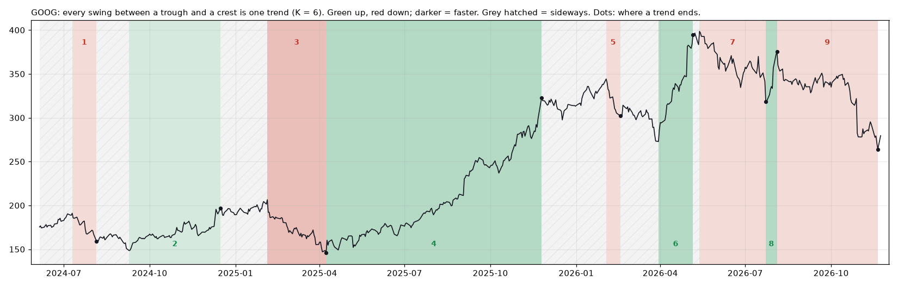
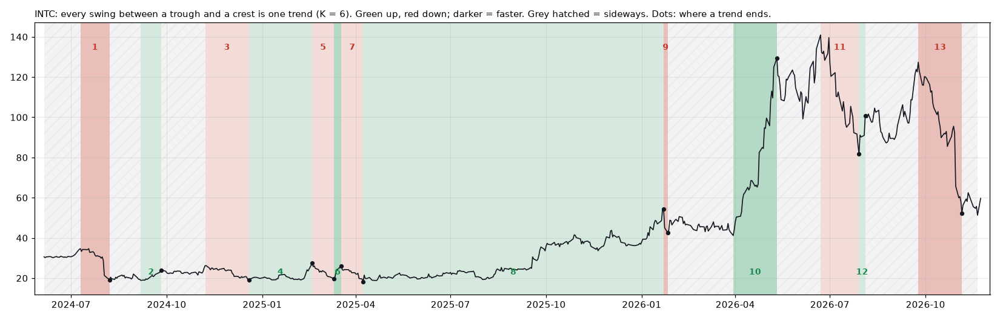
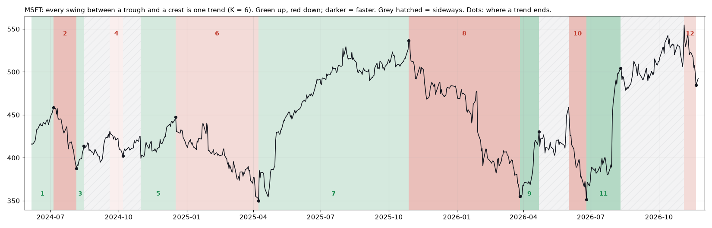
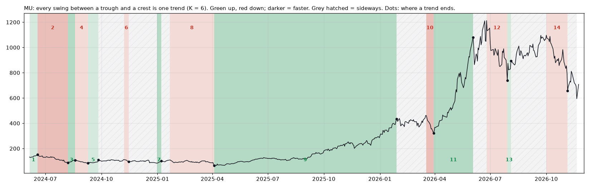
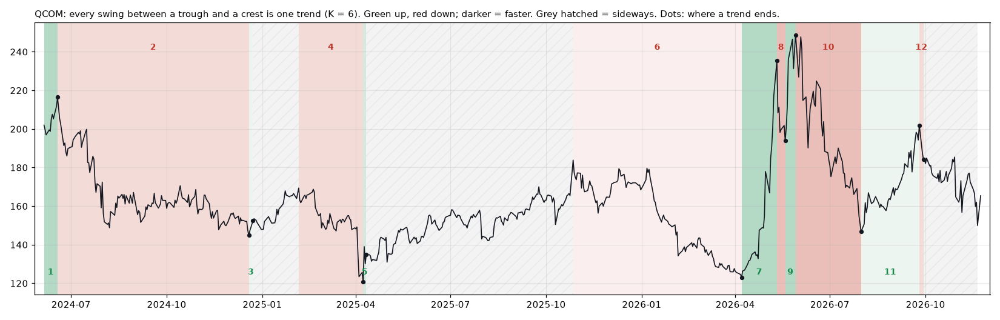
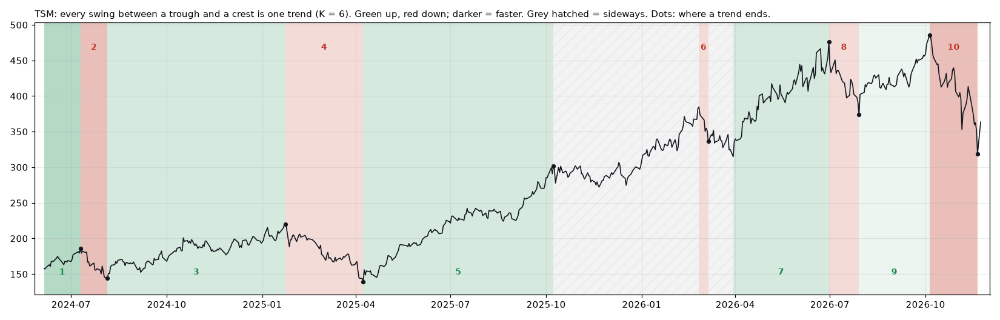

# The trends on the daily chart: every swing between a trough and a crest (third version, from the founder's marks)

Step 1 of the addition and subtraction pool (`docs/POOL_PLAN.md`). No news is used. A crest is marked when the price has fallen back from it by K usual daily moves of the stock, a trough the same way upward; a trend is the swing from one turn to the next. **K = 6**, the value that reproduces most of the founder's marks of 25 Nov (9 of 18): K=4: 7, K=5: 8, K=6: 9, K=7: 8, K=8: 8, K=9: 5, K=10: 5. 'Strength' = the move divided by how far the price drifts by chance in that many sessions (fast swings are darker); 'size' = the move in usual daily moves; 'first seen' = the day the swing could have been recognised with the prices known that day. The last swing of each stock is still running. **Sideways (founder, 25 Nov):** a trend ends where its move ended -- the day up to which its strength, counted from its start, is highest; what follows is cut off as 'sideways' (row 's', grey on the chart) when it lasts at least 5 sessions and moves less than one chance drift for its length. **To mark: which numbers are wrong, and what is missing.**

## AAPL

| no. | direction | from | to | sessions | move | size, usual daily moves | strength (speed) | straightness | first seen |
|---|---|---|---|---|---|---|---|---|---|
| 1 | up | 2024-04-19 | 2024-07-16 | 59 | +43% | 29 | 3.7 (fast) | 0.48 | 2024-05-03 |
| 2 | down | 2024-07-16 | 2024-08-06 | 15 | -12% | 9 | 2.3 (medium) | 0.65 | 2024-08-05 |
| 3 | up | 2024-08-06 | 2024-12-26 | 99 | +25% | 16 | 1.6 (slow) | 0.26 | 2024-08-16 |
| 4 | down | 2024-12-26 | 2025-01-21 | 15 | -14% | 11 | 2.7 (fast) | 0.68 | 2025-01-10 |
| 5 | up | 2025-01-21 | 2025-01-28 | 5 | +7% | 5 | 2.1 (medium) | 0.88 | 2025-02-14 |
| s | sideways | 2025-01-28 | 2025-02-24 | 18 | +4% | 3 | 0.6 (sideways) | 0.20 |  |
| 6 | down | 2025-02-24 | 2025-04-08 | 31 | -30% | 24 | 4.3 (fast) | 0.55 | 2025-03-11 |
| 7 | up | 2025-04-08 | 2025-12-02 | 164 | +67% | 29 | 2.2 (medium) | 0.26 | 2025-04-09 |
| 8 | down | 2025-12-02 | 2026-01-20 | 32 | -14% | 7 | 1.3 (slow) | 0.68 | 2026-01-20 |
| 9 | up | 2026-01-20 | 2026-02-06 | 13 | +13% | 6 | 1.7 (medium) | 0.83 | 2026-02-06 |
| 10 | down | 2026-02-06 | 2026-02-13 | 5 | -8% | 4 | 1.9 (medium) | 0.86 | 2026-03-30 |
| s | sideways | 2026-02-13 | 2026-03-30 | 30 | -4% | 2 | 0.3 (sideways) | 0.12 |  |
| 11 | up | 2026-03-30 | 2026-06-02 | 44 | +28% | 12 | 1.9 (medium) | 0.48 | 2026-04-17 |
| 12 | down | 2026-06-02 | 2026-06-25 | 16 | -13% | 10 | 2.4 (medium) | 0.55 | 2026-06-25 |
| 13 | up | 2026-06-25 | 2026-07-28 | 22 | +24% | 14 | 3.1 (fast) | 0.62 | 2026-07-02 |
| 14 | down | 2026-07-28 | 2026-08-03 | 4 | -11% | 7 | 3.7 (fast) | 1.00 | 2026-08-03 |
| s | sideways | 2026-08-03 | 2026-08-12 | 7 | -0% | 0 | 0.1 (sideways) | 0.04 |  |
| 15 | up | 2026-08-12 | 2026-09-22 | 28 | +12% | 7 | 1.4 (slow) | 0.41 | 2026-09-14 |
| s | sideways | 2026-09-22 | 2026-11-13 (running) | 38 | +5% | 3 | 0.5 (sideways) | 0.12 |  |

## AMD

| no. | direction | from | to | sessions | move | size, usual daily moves | strength (speed) | straightness | first seen |
|---|---|---|---|---|---|---|---|---|---|
| s | sideways | 2024-05-06 | 2024-07-10 | 44 | +18% | 6 | 0.8 (sideways) | 0.21 |  |
| 1 | down | 2024-07-10 | 2024-07-25 | 11 | -25% | 10 | 3.0 (fast) | 0.84 | 2024-07-19 |
| s | sideways | 2024-07-25 | 2024-08-07 | 9 | -7% | 2 | 0.8 (sideways) | 0.33 |  |
| 2 | up | 2024-08-07 | 2024-08-19 | 8 | +21% | 6 | 2.2 (medium) | 0.84 | 2024-08-19 |
| s | sideways | 2024-08-19 | 2024-10-08 | 35 | +11% | 4 | 0.6 (sideways) | 0.15 |  |
| 3 | down | 2024-10-08 | 2025-04-08 | 124 | -55% | 26 | 2.3 (medium) | 0.29 | 2024-11-01 |
| 4 | up | 2025-04-08 | 2025-08-13 | 87 | +136% | 29 | 3.1 (fast) | 0.39 | 2025-04-09 |
| 5 | down | 2025-08-13 | 2025-08-19 | 4 | -10% | 3 | 1.6 (slow) | 1.00 | 2025-09-05 |
| s | sideways | 2025-08-19 | 2025-09-05 | 12 | -9% | 3 | 0.9 (sideways) | 0.46 |  |
| 6 | up | 2025-09-05 | 2025-10-08 | 23 | +56% | 14 | 2.9 (fast) | 0.71 | 2025-10-06 |
| s | sideways | 2025-10-08 | 2025-10-29 | 15 | +12% | 3 | 0.8 (sideways) | 0.26 |  |
| 7 | down | 2025-10-29 | 2025-11-21 | 17 | -23% | 7 | 1.7 (medium) | 0.43 | 2025-11-20 |
| s | sideways | 2025-11-21 | 2025-12-17 | 17 | -3% | 1 | 0.2 (sideways) | 0.08 |  |
| 8 | up | 2025-12-17 | 2026-01-23 | 24 | +31% | 7 | 1.5 (slow) | 0.57 | 2026-01-21 |
| 9 | down | 2026-01-23 | 2026-02-05 | 9 | -26% | 8 | 2.7 (fast) | 0.77 | 2026-02-04 |
| s | sideways | 2026-02-05 | 2026-03-03 | 17 | -1% | 0 | 0.1 (sideways) | 0.02 |  |
| 10 | up | 2026-03-03 | 2026-06-03 | 64 | +184% | 26 | 3.3 (fast) | 0.48 | 2026-04-10 |
| s | sideways | 2026-06-03 | 2026-06-30 | 18 | +7% | 2 | 0.4 (sideways) | 0.08 |  |
| 11 | down | 2026-06-30 | 2026-07-29 | 20 | -26% | 7 | 1.6 (medium) | 0.35 | 2026-07-29 |
| 12 | up | 2026-07-29 | 2026-08-04 | 4 | +21% | 4 | 2.2 (medium) | 0.83 | 2026-09-21 |
| s | sideways | 2026-08-04 | 2026-10-06 | 44 | +25% | 5 | 0.8 (sideways) | 0.20 |  |
| 13 | down | 2026-10-06 | 2026-11-05 | 22 | -38% | 11 | 2.3 (medium) | 0.49 | 2026-11-02 |
| 14 | up | 2026-11-05 | 2026-11-12 | 5 | +45% | 8 | 3.7 (fast) | 1.00 | 2026-11-11 |
| 15 | down | 2026-11-12 | 2026-11-20 (running) | 6 | -27% | 7 | 2.9 (fast) | 0.76 | 2026-11-20 |

## AMZN

| no. | direction | from | to | sessions | move | size, usual daily moves | strength (speed) | straightness | first seen |
|---|---|---|---|---|---|---|---|---|---|
| 1 | up | 2023-10-26 | 2024-07-02 | 170 | +67% | 22 | 1.7 (medium) | 0.25 | 2023-11-02 |
| 2 | down | 2024-07-02 | 2024-08-05 | 23 | -19% | 12 | 2.6 (medium) | 0.56 | 2024-07-25 |
| 3 | up | 2024-08-05 | 2024-12-16 | 93 | +45% | 21 | 2.1 (medium) | 0.28 | 2024-08-21 |
| s | sideways | 2024-12-16 | 2025-02-04 | 32 | +4% | 2 | 0.4 (sideways) | 0.10 |  |
| 4 | down | 2025-02-04 | 2025-04-04 | 42 | -29% | 20 | 3.1 (fast) | 0.44 | 2025-02-21 |
| s | sideways | 2025-04-04 | 2025-04-21 | 10 | -2% | 1 | 0.4 (sideways) | 0.06 |  |
| 5 | up | 2025-04-21 | 2025-11-03 | 136 | +52% | 20 | 1.7 (medium) | 0.22 | 2025-05-01 |
| 6 | down | 2025-11-03 | 2025-11-20 | 13 | -15% | 7 | 2.0 (medium) | 0.73 | 2025-11-18 |
| 7 | up | 2025-11-20 | 2025-11-25 | 3 | +6% | 3 | 1.5 (slow) | 1.00 | 2026-01-09 |
| s | sideways | 2025-11-25 | 2026-01-09 | 30 | +8% | 3 | 0.6 (sideways) | 0.25 |  |
| 8 | down | 2026-01-09 | 2026-02-13 | 24 | -20% | 10 | 2.1 (medium) | 0.56 | 2026-02-06 |
| 9 | up | 2026-02-13 | 2026-05-06 | 56 | +38% | 15 | 2.0 (medium) | 0.39 | 2026-04-09 |
| 10 | down | 2026-05-06 | 2026-06-25 | 34 | -17% | 10 | 1.7 (medium) | 0.34 | 2026-06-08 |
| s | sideways | 2026-06-25 | 2026-07-29 | 23 | -0% | 0 | 0.0 (sideways) | 0.01 |  |
| 11 | up | 2026-07-29 | 2026-08-03 | 3 | +25% | 11 | 6.5 (fast) | 1.00 | 2026-07-31 |
| 12 | down | 2026-08-03 | 2026-08-05 | 2 | -4% | 2 | 1.3 (slow) | 1.00 | 2026-09-15 |
| s | sideways | 2026-08-05 | 2026-10-30 (running) | 61 | -12% | 6 | 0.8 (sideways) | 0.15 |  |

## AVGO

| no. | direction | from | to | sessions | move | size, usual daily moves | strength (speed) | straightness | first seen |
|---|---|---|---|---|---|---|---|---|---|
| 1 | up | 2024-04-19 | 2024-06-17 | 40 | +52% | 18 | 2.9 (fast) | 0.49 | 2024-05-15 |
| 2 | down | 2024-06-17 | 2024-08-07 | 35 | -25% | 13 | 2.1 (medium) | 0.30 | 2024-06-25 |
| 3 | up | 2024-08-07 | 2024-08-19 | 8 | +23% | 8 | 2.8 (fast) | 0.98 | 2024-08-15 |
| 4 | down | 2024-08-19 | 2024-09-06 | 13 | -18% | 8 | 2.1 (medium) | 0.56 | 2024-09-06 |
| 5 | up | 2024-09-06 | 2024-12-16 | 70 | +83% | 22 | 2.6 (medium) | 0.37 | 2024-09-12 |
| 6 | down | 2024-12-16 | 2025-04-04 | 74 | -41% | 16 | 1.9 (medium) | 0.26 | 2025-02-27 |
| 7 | up | 2025-04-04 | 2025-12-10 | 172 | +183% | 28 | 2.1 (medium) | 0.30 | 2025-04-09 |
| 8 | down | 2025-12-10 | 2025-12-15 | 3 | -18% | 5 | 3.1 (fast) | 1.00 | 2025-12-17 |
| s | sideways | 2025-12-15 | 2026-03-30 | 71 | -13% | 4 | 0.5 (sideways) | 0.11 |  |
| 9 | up | 2026-03-30 | 2026-04-22 | 16 | +44% | 12 | 3.0 (fast) | 0.91 | 2026-04-08 |
| s | sideways | 2026-04-22 | 2026-06-02 | 28 | +14% | 5 | 0.9 (sideways) | 0.23 |  |
| 10 | down | 2026-06-02 | 2026-06-05 | 3 | -20% | 8 | 4.8 (fast) | 1.00 | 2026-06-05 |
| s | sideways | 2026-06-05 | 2026-11-05 | 106 | -24% | 10 | 0.9 (sideways) | 0.12 |  |
| 11 | up | 2026-11-05 | 2026-11-12 (running) | 5 | +25% | 7 | 3.3 (fast) | 1.00 | 2026-11-12 |

## CRWD

| no. | direction | from | to | sessions | move | size, usual daily moves | strength (speed) | straightness | first seen |
|---|---|---|---|---|---|---|---|---|---|
| 1 | up | 2024-04-19 | 2024-06-12 | 37 | +37% | 12 | 2.0 (medium) | 0.38 | 2024-05-14 |
| s | sideways | 2024-06-12 | 2024-07-01 | 12 | +1% | 0 | 0.1 (sideways) | 0.08 |  |
| 2 | down | 2024-07-01 | 2024-08-02 | 23 | -44% | 22 | 4.6 (fast) | 0.81 | 2024-07-19 |
| 3 | up | 2024-08-02 | 2025-02-18 | 135 | +109% | 25 | 2.2 (medium) | 0.28 | 2024-08-15 |
| 4 | down | 2025-02-18 | 2025-03-10 | 14 | -32% | 13 | 3.5 (fast) | 0.70 | 2025-02-25 |
| 5 | up | 2025-03-10 | 2025-07-03 | 80 | +66% | 17 | 1.9 (medium) | 0.25 | 2025-03-19 |
| 6 | down | 2025-07-03 | 2025-08-07 | 24 | -17% | 6 | 1.2 (slow) | 0.48 | 2025-08-07 |
| s | sideways | 2025-08-07 | 2025-09-04 | 19 | -3% | 1 | 0.2 (sideways) | 0.12 |  |
| 7 | up | 2025-09-04 | 2025-09-18 | 10 | +22% | 7 | 2.2 (medium) | 0.90 | 2025-09-18 |
| s | sideways | 2025-09-18 | 2025-11-10 | 37 | +11% | 3 | 0.6 (sideways) | 0.17 |  |
| 8 | down | 2025-11-10 | 2026-02-24 | 71 | -37% | 16 | 1.9 (medium) | 0.32 | 2025-12-31 |
| 9 | up | 2026-02-24 | 2026-03-11 | 11 | +26% | 8 | 2.4 (medium) | 0.83 | 2026-03-05 |
| 10 | down | 2026-03-11 | 2026-03-27 | 12 | -16% | 6 | 1.8 (medium) | 0.61 | 2026-03-27 |
| 11 | up | 2026-03-27 | 2026-06-01 | 44 | +112% | 26 | 4.0 (fast) | 0.59 | 2026-04-21 |
| 12 | down | 2026-06-01 | 2026-06-09 | 6 | -18% | 7 | 2.8 (fast) | 1.00 | 2026-06-08 |
| 13 | up | 2026-06-09 | 2026-07-14 | 23 | +31% | 9 | 2.0 (medium) | 0.46 | 2026-07-01 |
| s | sideways | 2026-07-14 | 2026-08-13 | 22 | +7% | 2 | 0.5 (sideways) | 0.14 |  |
| 14 | down | 2026-08-13 | 2026-08-25 | 8 | -18% | 6 | 2.3 (medium) | 0.92 | 2026-08-25 |
| 15 | up | 2026-08-25 | 2026-10-06 | 29 | +50% | 13 | 2.5 (medium) | 0.41 | 2026-08-27 |
| 16 | down | 2026-10-06 | 2026-10-16 | 8 | -18% | 6 | 2.1 (medium) | 0.70 | 2026-11-05 |
| s | sideways | 2026-10-16 | 2026-11-23 (running) | 26 | -8% | 2 | 0.5 (sideways) | 0.11 |  |

## CSCO

| no. | direction | from | to | sessions | move | size, usual daily moves | strength (speed) | straightness | first seen |
|---|---|---|---|---|---|---|---|---|---|
| s | sideways | 2024-01-31 | 2024-06-13 | 93 | -9% | 7 | 0.7 (sideways) | 0.13 |  |
| 1 | up | 2024-06-13 | 2024-06-21 | 5 | +4% | 3 | 1.4 (slow) | 1.00 | 2024-07-17 |
| s | sideways | 2024-06-21 | 2024-07-17 | 17 | +3% | 3 | 0.7 (sideways) | 0.30 |  |
| 2 | down | 2024-07-17 | 2024-08-05 | 13 | -8% | 7 | 1.9 (medium) | 0.48 | 2024-08-05 |
| 3 | up | 2024-08-05 | 2025-02-14 | 133 | +47% | 32 | 2.7 (fast) | 0.36 | 2024-08-15 |
| 4 | down | 2025-02-14 | 2025-04-08 | 36 | -17% | 17 | 2.8 (fast) | 0.45 | 2025-03-13 |
| 5 | up | 2025-04-08 | 2026-02-09 | 210 | +66% | 39 | 2.7 (fast) | 0.23 | 2025-04-09 |
| 6 | down | 2026-02-09 | 2026-02-12 | 3 | -14% | 10 | 5.5 (fast) | 1.00 | 2026-02-12 |
| 7 | up | 2026-02-12 | 2026-06-04 | 77 | +74% | 32 | 3.6 (fast) | 0.43 | 2026-04-08 |
| 8 | down | 2026-06-04 | 2026-11-20 (running) | 118 | -30% | 19 | 1.7 (medium) | 0.17 | 2026-06-26 |

## EMR

| no. | direction | from | to | sessions | move | size, usual daily moves | strength (speed) | straightness | first seen |
|---|---|---|---|---|---|---|---|---|---|
| 1 | down | 2024-05-09 | 2024-06-06 | 19 | -8% | 6 | 1.4 (slow) | 0.44 | 2024-06-06 |
| 2 | up | 2024-06-06 | 2024-07-16 | 26 | +12% | 8 | 1.7 (medium) | 0.39 | 2024-07-15 |
| 3 | down | 2024-07-16 | 2024-08-07 | 16 | -16% | 13 | 3.2 (fast) | 0.54 | 2024-08-05 |
| s | sideways | 2024-08-07 | 2024-09-06 | 21 | -1% | 1 | 0.1 (sideways) | 0.04 |  |
| 4 | up | 2024-09-06 | 2024-11-25 | 56 | +36% | 19 | 2.6 (fast) | 0.48 | 2024-09-26 |
| s | sideways | 2024-11-25 | 2024-12-04 | 6 | +1% | 1 | 0.3 (sideways) | 0.50 |  |
| 5 | down | 2024-12-04 | 2024-12-18 | 10 | -9% | 6 | 1.8 (medium) | 0.75 | 2025-01-07 |
| s | sideways | 2024-12-18 | 2025-01-10 | 14 | -4% | 2 | 0.6 (sideways) | 0.30 |  |
| 6 | up | 2025-01-10 | 2025-01-23 | 8 | +11% | 6 | 2.3 (medium) | 1.00 | 2025-01-23 |
| 7 | down | 2025-01-23 | 2025-04-08 | 52 | -28% | 20 | 2.7 (fast) | 0.38 | 2025-03-03 |
| 8 | up | 2025-04-08 | 2025-07-25 | 74 | +60% | 25 | 3.0 (fast) | 0.48 | 2025-05-02 |
| 9 | down | 2025-07-25 | 2025-08-07 | 9 | -11% | 6 | 2.0 (medium) | 0.91 | 2025-08-07 |
| s | sideways | 2025-08-07 | 2025-11-20 | 74 | -6% | 3 | 0.4 (sideways) | 0.07 |  |
| 10 | up | 2025-11-20 | 2026-02-10 | 54 | +31% | 14 | 1.9 (medium) | 0.34 | 2025-12-11 |
| 11 | down | 2026-02-10 | 2026-03-30 | 33 | -23% | 14 | 2.4 (medium) | 0.44 | 2026-03-05 |
| 12 | up | 2026-03-30 | 2026-04-09 | 7 | +17% | 8 | 2.9 (fast) | 0.94 | 2026-04-08 |
| s | sideways | 2026-04-09 | 2026-05-06 | 19 | +2% | 1 | 0.3 (sideways) | 0.07 |  |
| 13 | down | 2026-05-06 | 2026-05-19 | 9 | -11% | 6 | 2.1 (medium) | 0.91 | 2026-05-19 |
| 14 | up | 2026-05-19 | 2026-05-26 | 4 | +8% | 4 | 2.0 (medium) | 1.00 | 2026-06-16 |
| s | sideways | 2026-05-26 | 2026-10-29 (running) | 109 | +22% | 10 | 1.0 (sideways) | 0.13 |  |

## GE

| no. | direction | from | to | sessions | move | size, usual daily moves | strength (speed) | straightness | first seen |
|---|---|---|---|---|---|---|---|---|---|
| s | sideways | 2024-05-07 | 2024-10-21 | 115 | +15% | 9 | 0.8 (sideways) | 0.10 |  |
| 1 | down | 2024-10-21 | 2024-12-18 | 41 | -18% | 11 | 1.7 (medium) | 0.31 | 2024-10-31 |
| 2 | up | 2024-12-18 | 2025-01-23 | 22 | +26% | 12 | 2.5 (medium) | 0.73 | 2025-01-15 |
| s | sideways | 2025-01-23 | 2025-03-25 | 42 | +6% | 3 | 0.4 (sideways) | 0.11 |  |
| 3 | down | 2025-03-25 | 2025-04-04 | 8 | -21% | 12 | 4.2 (fast) | 0.86 | 2025-04-03 |
| 4 | up | 2025-04-04 | 2026-03-02 | 226 | +108% | 35 | 2.3 (medium) | 0.25 | 2025-04-23 |
| 5 | down | 2026-03-02 | 2026-03-30 | 20 | -21% | 12 | 2.6 (fast) | 0.59 | 2026-03-13 |
| 6 | up | 2026-03-30 | 2026-04-14 | 10 | +16% | 7 | 2.3 (medium) | 0.58 | 2026-04-08 |
| 7 | down | 2026-04-14 | 2026-04-22 | 6 | -13% | 8 | 3.1 (fast) | 0.78 | 2026-04-22 |
| 8 | up | 2026-04-22 | 2026-07-06 | 50 | +37% | 17 | 2.4 (medium) | 0.39 | 2026-05-26 |
| s | sideways | 2026-07-06 | 2026-08-05 | 22 | +1% | 0 | 0.1 (sideways) | 0.02 |  |
| 9 | down | 2026-08-05 | 2026-09-15 | 28 | -19% | 11 | 2.0 (medium) | 0.49 | 2026-08-31 |
| s | sideways | 2026-09-15 | 2026-10-23 | 28 | -7% | 3 | 0.6 (sideways) | 0.24 |  |
| 10 | up | 2026-10-23 | 2026-11-11 (running) | 13 | +20% | 9 | 2.4 (medium) | 0.53 | 2026-11-04 |

## GOOG

| no. | direction | from | to | sessions | move | size, usual daily moves | strength (speed) | straightness | first seen |
|---|---|---|---|---|---|---|---|---|---|
| s | sideways | 2024-04-26 | 2024-07-10 | 50 | +11% | 6 | 0.8 (sideways) | 0.21 |  |
| 1 | down | 2024-07-10 | 2024-08-05 | 18 | -17% | 10 | 2.5 (medium) | 0.61 | 2024-07-25 |
| s | sideways | 2024-08-05 | 2024-09-09 | 24 | -7% | 4 | 0.8 (sideways) | 0.24 |  |
| 2 | up | 2024-09-09 | 2024-12-16 | 69 | +33% | 16 | 1.9 (medium) | 0.32 | 2024-09-30 |
| s | sideways | 2024-12-16 | 2025-02-04 | 32 | +5% | 3 | 0.5 (sideways) | 0.11 |  |
| 3 | down | 2025-02-04 | 2025-04-08 | 44 | -29% | 20 | 3.0 (fast) | 0.45 | 2025-02-12 |
| 4 | up | 2025-04-08 | 2025-11-25 | 160 | +121% | 43 | 3.4 (fast) | 0.34 | 2025-05-02 |
| s | sideways | 2025-11-25 | 2026-02-02 | 45 | +7% | 3 | 0.5 (sideways) | 0.14 |  |
| 5 | down | 2026-02-02 | 2026-02-17 | 10 | -12% | 7 | 2.1 (medium) | 0.94 | 2026-02-13 |
| s | sideways | 2026-02-17 | 2026-03-30 | 29 | -10% | 5 | 1.0 (sideways) | 0.29 |  |
| 6 | up | 2026-03-30 | 2026-05-06 | 26 | +45% | 20 | 3.9 (fast) | 0.79 | 2026-04-08 |
| s | sideways | 2026-05-06 | 2026-05-13 | 5 | +1% | 1 | 0.2 (sideways) | 0.13 |  |
| 7 | down | 2026-05-13 | 2026-07-23 | 48 | -20% | 13 | 1.8 (medium) | 0.29 | 2026-06-02 |
| 8 | up | 2026-07-23 | 2026-08-04 | 8 | +18% | 8 | 3.0 (fast) | 0.93 | 2026-08-03 |
| 9 | down | 2026-08-04 | 2026-11-20 (running) | 77 | -30% | 18 | 2.0 (medium) | 0.33 | 2026-09-01 |

## IBM

| no. | direction | from | to | sessions | move | size, usual daily moves | strength (speed) | straightness | first seen |
|---|---|---|---|---|---|---|---|---|---|
| 1 | up | 2024-05-01 | 2024-10-14 | 114 | +46% | 29 | 2.7 (fast) | 0.40 | 2024-07-02 |
| 2 | down | 2024-10-14 | 2024-10-30 | 12 | -13% | 10 | 3.0 (fast) | 0.90 | 2024-10-25 |
| 3 | up | 2024-10-30 | 2024-12-06 | 26 | +17% | 11 | 2.2 (medium) | 0.60 | 2024-11-21 |
| 4 | down | 2024-12-06 | 2024-12-18 | 8 | -8% | 5 | 1.9 (medium) | 0.70 | 2025-01-13 |
| s | sideways | 2024-12-18 | 2025-01-13 | 15 | -1% | 1 | 0.2 (sideways) | 0.11 |  |
| 5 | up | 2025-01-13 | 2025-02-04 | 15 | +22% | 13 | 3.4 (fast) | 0.79 | 2025-01-30 |
| s | sideways | 2025-02-04 | 2025-02-20 | 11 | +1% | 0 | 0.2 (sideways) | 0.07 |  |
| 6 | down | 2025-02-20 | 2025-04-08 | 33 | -17% | 12 | 2.0 (medium) | 0.35 | 2025-04-04 |
| 7 | up | 2025-04-08 | 2025-06-30 | 56 | +34% | 18 | 2.3 (medium) | 0.39 | 2025-04-23 |
| 8 | down | 2025-06-30 | 2025-08-12 | 30 | -20% | 13 | 2.3 (medium) | 0.65 | 2025-07-24 |
| 9 | up | 2025-08-12 | 2025-10-27 | 53 | +33% | 16 | 2.2 (medium) | 0.41 | 2025-09-18 |
| s | sideways | 2025-10-27 | 2025-11-12 | 12 | +1% | 1 | 0.2 (sideways) | 0.08 |  |
| 10 | down | 2025-11-12 | 2026-02-23 | 68 | -29% | 18 | 2.2 (medium) | 0.28 | 2026-02-11 |
| 11 | up | 2026-02-23 | 2026-03-06 | 9 | +16% | 7 | 2.3 (medium) | 0.87 | 2026-03-05 |
| 12 | down | 2026-03-06 | 2026-05-13 | 47 | -16% | 8 | 1.2 (slow) | 0.23 | 2026-04-27 |
| 13 | up | 2026-05-13 | 2026-06-02 | 13 | +53% | 20 | 5.6 (fast) | 0.94 | 2026-05-21 |
| 14 | down | 2026-06-02 | 2026-06-18 | 12 | -24% | 12 | 3.3 (fast) | 0.89 | 2026-06-08 |
| 15 | up | 2026-06-18 | 2026-07-07 | 11 | +23% | 8 | 2.5 (medium) | 0.80 | 2026-07-06 |
| 16 | down | 2026-07-07 | 2026-07-14 | 5 | -29% | 13 | 6.0 (fast) | 0.95 | 2026-07-14 |
| s | sideways | 2026-07-14 | 2026-07-22 | 6 | -5% | 2 | 0.7 (sideways) | 0.41 |  |
| 17 | up | 2026-07-22 | 2026-07-28 | 4 | +11% | 3 | 1.6 (slow) | 1.00 | 2026-09-14 |
| s | sideways | 2026-07-28 | 2026-10-29 (running) | 66 | +14% | 4 | 0.5 (sideways) | 0.14 |  |

## INTC

| no. | direction | from | to | sessions | move | size, usual daily moves | strength (speed) | straightness | first seen |
|---|---|---|---|---|---|---|---|---|---|
| s | sideways | 2024-05-16 | 2024-07-10 | 36 | +9% | 3 | 0.6 (sideways) | 0.18 |  |
| 1 | down | 2024-07-10 | 2024-08-07 | 20 | -45% | 25 | 5.6 (fast) | 0.78 | 2024-07-30 |
| s | sideways | 2024-08-07 | 2024-09-06 | 21 | -1% | 0 | 0.0 (sideways) | 0.01 |  |
| 2 | up | 2024-09-06 | 2024-09-26 | 14 | +27% | 7 | 1.9 (medium) | 0.69 | 2024-09-25 |
| s | sideways | 2024-09-26 | 2024-11-07 | 30 | +10% | 3 | 0.5 (sideways) | 0.14 |  |
| 3 | down | 2024-11-07 | 2024-12-19 | 29 | -27% | 9 | 1.8 (medium) | 0.49 | 2024-12-05 |
| 4 | up | 2024-12-19 | 2025-02-18 | 38 | +44% | 11 | 1.7 (medium) | 0.38 | 2025-02-13 |
| 5 | down | 2025-02-18 | 2025-03-11 | 15 | -28% | 9 | 2.4 (medium) | 0.72 | 2025-03-04 |
| 6 | up | 2025-03-11 | 2025-03-18 | 5 | +31% | 8 | 3.4 (fast) | 1.00 | 2025-03-17 |
| 7 | down | 2025-03-18 | 2025-04-08 | 15 | -30% | 10 | 2.5 (medium) | 0.81 | 2025-04-04 |
| 8 | up | 2025-04-08 | 2026-01-22 | 198 | +200% | 29 | 2.0 (medium) | 0.20 | 2025-07-08 |
| 9 | down | 2026-01-22 | 2026-01-26 | 2 | -22% | 6 | 4.3 (fast) | 1.00 | 2026-03-30 |
| s | sideways | 2026-01-26 | 2026-03-30 | 44 | -3% | 1 | 0.1 (sideways) | 0.02 |  |
| 10 | up | 2026-03-30 | 2026-05-11 | 29 | +214% | 28 | 5.2 (fast) | 0.79 | 2026-04-07 |
| s | sideways | 2026-05-11 | 2026-06-22 | 28 | +9% | 2 | 0.4 (sideways) | 0.07 |  |
| 11 | down | 2026-06-22 | 2026-07-29 | 26 | -42% | 12 | 2.3 (medium) | 0.49 | 2026-07-13 |
| 12 | up | 2026-07-29 | 2026-08-04 | 4 | +23% | 4 | 2.2 (medium) | 0.91 | 2026-09-21 |
| s | sideways | 2026-08-04 | 2026-09-24 | 36 | +26% | 5 | 0.8 (sideways) | 0.22 |  |
| 13 | down | 2026-09-24 | 2026-11-05 | 30 | -59% | 19 | 3.4 (fast) | 0.67 | 2026-10-15 |
| s | sideways | 2026-11-05 | 2026-11-20 (running) | 11 | -2% | 0 | 0.1 (sideways) | 0.04 |  |

## META

| no. | direction | from | to | sessions | move | size, usual daily moves | strength (speed) | straightness | first seen |
|---|---|---|---|---|---|---|---|---|---|
| 1 | up | 2024-04-30 | 2024-07-05 | 45 | +26% | 10 | 1.5 (slow) | 0.42 | 2024-06-05 |
| 2 | down | 2024-07-05 | 2024-07-17 | 8 | -14% | 7 | 2.5 (medium) | 0.89 | 2024-07-17 |
| s | sideways | 2024-07-17 | 2024-07-25 | 6 | -2% | 1 | 0.3 (sideways) | 0.14 |  |
| 3 | up | 2024-07-25 | 2025-02-14 | 140 | +63% | 21 | 1.8 (medium) | 0.27 | 2024-08-13 |
| 4 | down | 2025-02-14 | 2025-04-04 | 34 | -31% | 20 | 3.4 (fast) | 0.46 | 2025-03-03 |
| 5 | up | 2025-04-04 | 2025-04-09 | 3 | +16% | 7 | 4.1 (fast) | 0.87 | 2025-04-09 |
| 6 | down | 2025-04-09 | 2025-04-21 | 7 | -17% | 8 | 3.1 (fast) | 1.00 | 2025-04-16 |
| 7 | up | 2025-04-21 | 2025-08-12 | 78 | +63% | 21 | 2.4 (medium) | 0.40 | 2025-05-01 |
| 8 | down | 2025-08-12 | 2025-11-20 | 71 | -25% | 13 | 1.5 (slow) | 0.34 | 2025-10-30 |
| 9 | up | 2025-11-20 | 2025-11-25 | 3 | +8% | 3 | 1.9 (medium) | 1.00 | 2026-01-29 |
| s | sideways | 2025-11-25 | 2026-01-29 | 43 | +16% | 6 | 0.9 (sideways) | 0.23 |  |
| 10 | down | 2026-01-29 | 2026-03-27 | 40 | -29% | 14 | 2.2 (medium) | 0.50 | 2026-03-12 |
| 11 | up | 2026-03-27 | 2026-04-17 | 14 | +31% | 11 | 2.9 (fast) | 0.93 | 2026-04-08 |
| 12 | down | 2026-04-17 | 2026-04-30 | 9 | -11% | 5 | 1.8 (medium) | 0.61 | 2026-05-11 |
| s | sideways | 2026-04-30 | 2026-06-25 | 38 | -11% | 5 | 0.9 (sideways) | 0.20 |  |
| 13 | up | 2026-06-25 | 2026-07-15 | 13 | +26% | 10 | 2.8 (fast) | 0.56 | 2026-07-09 |
| 14 | down | 2026-07-15 | 2026-07-30 | 11 | -21% | 10 | 2.9 (fast) | 1.00 | 2026-07-29 |
| 15 | up | 2026-07-30 | 2026-09-24 | 39 | +44% | 15 | 2.4 (medium) | 0.48 | 2026-09-09 |
| 16 | down | 2026-09-24 | 2026-11-20 (running) | 41 | -28% | 13 | 2.0 (medium) | 0.38 | 2026-10-22 |

## MSFT

| no. | direction | from | to | sessions | move | size, usual daily moves | strength (speed) | straightness | first seen |
|---|---|---|---|---|---|---|---|---|---|
| 1 | up | 2024-04-30 | 2024-07-05 | 45 | +20% | 14 | 2.1 (medium) | 0.50 | 2024-05-15 |
| 2 | down | 2024-07-05 | 2024-08-05 | 21 | -15% | 13 | 2.9 (fast) | 0.62 | 2024-07-24 |
| 3 | up | 2024-08-05 | 2024-08-15 | 8 | +7% | 5 | 1.8 (medium) | 0.92 | 2024-09-12 |
| s | sideways | 2024-08-15 | 2024-09-19 | 24 | +4% | 3 | 0.7 (sideways) | 0.18 |  |
| 4 | down | 2024-09-19 | 2024-10-07 | 12 | -7% | 5 | 1.6 (slow) | 0.74 | 2024-10-31 |
| s | sideways | 2024-10-07 | 2024-10-31 | 18 | -1% | 1 | 0.1 (sideways) | 0.05 |  |
| 5 | up | 2024-10-31 | 2024-12-17 | 32 | +12% | 9 | 1.6 (medium) | 0.41 | 2024-12-04 |
| 6 | down | 2024-12-17 | 2025-04-08 | 75 | -22% | 20 | 2.3 (medium) | 0.28 | 2025-01-02 |
| 7 | up | 2025-04-08 | 2025-10-28 | 140 | +53% | 31 | 2.6 (medium) | 0.33 | 2025-04-09 |
| 8 | down | 2025-10-28 | 2026-03-27 | 103 | -34% | 27 | 2.6 (fast) | 0.32 | 2025-11-18 |
| 9 | up | 2026-03-27 | 2026-04-22 | 17 | +21% | 12 | 2.8 (fast) | 0.79 | 2026-04-14 |
| s | sideways | 2026-04-22 | 2026-06-01 | 27 | +7% | 4 | 0.8 (sideways) | 0.16 |  |
| 10 | down | 2026-06-01 | 2026-06-25 | 17 | -23% | 17 | 4.1 (fast) | 0.75 | 2026-06-05 |
| 11 | up | 2026-06-25 | 2026-08-10 | 31 | +43% | 22 | 3.9 (fast) | 0.56 | 2026-07-15 |
| s | sideways | 2026-08-10 | 2026-11-04 | 61 | +10% | 5 | 0.6 (sideways) | 0.13 |  |
| 12 | down | 2026-11-04 | 2026-11-20 (running) | 12 | -13% | 6 | 1.9 (medium) | 0.65 | 2026-11-20 |

## MU

| no. | direction | from | to | sessions | move | size, usual daily moves | strength (speed) | straightness | first seen |
|---|---|---|---|---|---|---|---|---|---|
| 1 | up | 2024-04-19 | 2024-06-18 | 41 | +44% | 15 | 2.4 (medium) | 0.44 | 2024-05-13 |
| 2 | down | 2024-06-18 | 2024-08-07 | 34 | -43% | 24 | 4.2 (fast) | 0.56 | 2024-06-27 |
| 3 | up | 2024-08-07 | 2024-08-19 | 8 | +25% | 8 | 3.0 (fast) | 1.00 | 2024-08-15 |
| 4 | down | 2024-08-19 | 2024-09-09 | 14 | -21% | 9 | 2.3 (medium) | 0.81 | 2024-09-03 |
| 5 | up | 2024-09-09 | 2024-09-26 | 13 | +27% | 9 | 2.4 (medium) | 0.55 | 2024-09-26 |
| s | sideways | 2024-09-26 | 2024-11-07 | 30 | +3% | 1 | 0.2 (sideways) | 0.05 |  |
| 6 | down | 2024-11-07 | 2024-11-15 | 6 | -15% | 5 | 2.2 (medium) | 1.00 | 2024-12-19 |
| s | sideways | 2024-11-15 | 2024-12-31 | 30 | -13% | 4 | 0.8 (sideways) | 0.17 |  |
| 7 | up | 2024-12-31 | 2025-01-07 | 4 | +21% | 6 | 2.9 (fast) | 1.00 | 2025-01-15 |
| s | sideways | 2025-01-07 | 2025-01-21 | 8 | +7% | 2 | 0.8 (sideways) | 0.32 |  |
| 8 | down | 2025-01-21 | 2025-04-04 | 52 | -41% | 16 | 2.2 (medium) | 0.28 | 2025-01-28 |
| 9 | up | 2025-04-04 | 2026-01-28 | 204 | +574% | 50 | 3.5 (fast) | 0.33 | 2025-05-07 |
| s | sideways | 2026-01-28 | 2026-03-18 | 34 | +6% | 1 | 0.3 (sideways) | 0.05 |  |
| 10 | down | 2026-03-18 | 2026-03-30 | 8 | -30% | 9 | 3.2 (fast) | 0.97 | 2026-03-26 |
| 11 | up | 2026-03-30 | 2026-06-03 | 45 | +235% | 30 | 4.4 (fast) | 0.63 | 2026-04-08 |
| s | sideways | 2026-06-03 | 2026-06-25 | 15 | +12% | 3 | 0.7 (sideways) | 0.10 |  |
| 12 | down | 2026-06-25 | 2026-07-29 | 23 | -39% | 11 | 2.2 (medium) | 0.45 | 2026-07-15 |
| 13 | up | 2026-07-29 | 2026-08-04 | 4 | +21% | 4 | 1.9 (medium) | 0.61 | 2026-08-17 |
| s | sideways | 2026-08-04 | 2026-10-01 | 41 | +23% | 4 | 0.6 (sideways) | 0.21 |  |
| 14 | down | 2026-10-01 | 2026-11-05 | 25 | -40% | 10 | 2.0 (medium) | 0.49 | 2026-11-04 |
| s | sideways | 2026-11-05 | 2026-11-20 (running) | 11 | -9% | 2 | 0.6 (sideways) | 0.18 |  |

## NVDA

| no. | direction | from | to | sessions | move | size, usual daily moves | strength (speed) | straightness | first seen |
|---|---|---|---|---|---|---|---|---|---|
| 1 | up | 2024-04-19 | 2024-06-18 | 41 | +78% | 19 | 3.0 (fast) | 0.56 | 2024-05-06 |
| 2 | down | 2024-06-18 | 2024-08-07 | 34 | -27% | 11 | 2.0 (medium) | 0.26 | 2024-07-25 |
| 3 | up | 2024-08-07 | 2024-08-19 | 8 | +31% | 9 | 3.1 (fast) | 0.98 | 2024-08-15 |
| 4 | down | 2024-08-19 | 2024-09-06 | 13 | -21% | 8 | 2.1 (medium) | 0.56 | 2024-09-04 |
| 5 | up | 2024-09-06 | 2024-09-11 | 3 | +14% | 4 | 2.3 (medium) | 1.00 | 2024-10-07 |
| s | sideways | 2024-09-11 | 2025-01-06 | 80 | +28% | 8 | 0.8 (sideways) | 0.16 |  |
| 6 | down | 2025-01-06 | 2025-01-27 | 13 | -21% | 7 | 2.0 (medium) | 0.47 | 2025-01-27 |
| s | sideways | 2025-01-27 | 2025-04-04 | 48 | -20% | 6 | 0.9 (sideways) | 0.15 |  |
| 7 | up | 2025-04-04 | 2025-10-29 | 143 | +120% | 22 | 1.8 (medium) | 0.31 | 2025-05-12 |
| 8 | down | 2025-10-29 | 2025-11-06 | 6 | -9% | 3 | 1.2 (slow) | 0.69 | 2025-12-17 |
| s | sideways | 2025-11-06 | 2026-03-30 | 97 | -12% | 4 | 0.4 (sideways) | 0.08 |  |
| 9 | up | 2026-03-30 | 2026-05-14 | 32 | +43% | 14 | 2.5 (medium) | 0.59 | 2026-04-10 |
| 10 | down | 2026-05-14 | 2026-07-29 | 51 | -19% | 10 | 1.4 (slow) | 0.20 | 2026-06-05 |
| 11 | up | 2026-07-29 | 2026-08-05 | 5 | +15% | 6 | 2.8 (fast) | 1.00 | 2026-08-05 |
| s | sideways | 2026-08-05 | 2026-10-06 | 43 | +9% | 4 | 0.6 (sideways) | 0.13 |  |
| 12 | down | 2026-10-06 | 2026-11-20 | 33 | -48% | 27 | 4.7 (fast) | 0.67 | 2026-10-30 |
| 13 | up | 2026-11-20 | 2026-11-23 (running) | 1 | +31% | 10 | 10.4 (fast) | 1.00 | 2026-11-23 |

## ORCL

| no. | direction | from | to | sessions | move | size, usual daily moves | strength (speed) | straightness | first seen |
|---|---|---|---|---|---|---|---|---|---|
| 1 | up | 2023-12-14 | 2024-07-12 | 143 | +46% | 19 | 1.6 (medium) | 0.22 | 2024-01-24 |
| 2 | down | 2024-07-12 | 2024-08-07 | 18 | -13% | 6 | 1.5 (slow) | 0.48 | 2024-08-07 |
| 3 | up | 2024-08-07 | 2024-09-16 | 27 | +35% | 14 | 2.6 (fast) | 0.73 | 2024-09-10 |
| s | sideways | 2024-09-16 | 2024-11-21 | 48 | +13% | 6 | 0.9 (sideways) | 0.23 |  |
| 4 | down | 2024-11-21 | 2025-01-13 | 33 | -20% | 11 | 1.8 (medium) | 0.44 | 2024-12-17 |
| 5 | up | 2025-01-13 | 2025-01-23 | 7 | +21% | 10 | 3.6 (fast) | 1.00 | 2025-01-22 |
| 6 | down | 2025-01-23 | 2025-04-21 | 60 | -34% | 20 | 2.5 (medium) | 0.26 | 2025-01-27 |
| 7 | up | 2025-04-21 | 2025-09-10 | 98 | +168% | 38 | 3.8 (fast) | 0.48 | 2025-05-01 |
| 8 | down | 2025-09-10 | 2026-02-05 | 102 | -58% | 26 | 2.6 (medium) | 0.32 | 2025-10-30 |
| 9 | up | 2026-02-05 | 2026-06-01 | 79 | +82% | 17 | 1.9 (medium) | 0.27 | 2026-04-15 |
| 10 | down | 2026-06-01 | 2026-07-24 | 37 | -53% | 20 | 3.3 (fast) | 0.63 | 2026-06-11 |
| 11 | up | 2026-07-24 | 2026-08-04 | 7 | +27% | 6 | 2.3 (medium) | 0.86 | 2026-08-07 |
| s | sideways | 2026-08-04 | 2026-09-08 | 24 | +12% | 3 | 0.5 (sideways) | 0.18 |  |
| 12 | down | 2026-09-08 | 2026-11-20 (running) | 53 | -38% | 11 | 1.6 (slow) | 0.27 | 2026-10-16 |

## QCOM

| no. | direction | from | to | sessions | move | size, usual daily moves | strength (speed) | straightness | first seen |
|---|---|---|---|---|---|---|---|---|---|
| 1 | up | 2023-10-25 | 2024-06-18 | 162 | +120% | 34 | 2.7 (fast) | 0.34 | 2023-11-06 |
| 2 | down | 2024-06-18 | 2024-12-19 | 128 | -33% | 21 | 1.9 (medium) | 0.16 | 2024-06-24 |
| 3 | up | 2024-12-19 | 2024-12-23 | 2 | +5% | 2 | 1.5 (slow) | 1.00 | 2025-01-23 |
| s | sideways | 2024-12-23 | 2025-02-05 | 28 | +11% | 4 | 0.8 (sideways) | 0.32 |  |
| 4 | down | 2025-02-05 | 2025-04-08 | 43 | -29% | 14 | 2.2 (medium) | 0.41 | 2025-04-03 |
| 5 | up | 2025-04-08 | 2025-04-11 | 3 | +12% | 4 | 2.5 (medium) | 0.46 | 2025-04-24 |
| s | sideways | 2025-04-11 | 2025-10-27 | 136 | +36% | 11 | 1.0 (sideways) | 0.17 |  |
| 6 | down | 2025-10-27 | 2026-04-07 | 110 | -33% | 17 | 1.6 (slow) | 0.25 | 2025-11-20 |
| 7 | up | 2026-04-07 | 2026-05-11 | 24 | +91% | 28 | 5.8 (fast) | 0.77 | 2026-04-24 |
| 8 | down | 2026-05-11 | 2026-05-19 | 6 | -18% | 8 | 3.2 (fast) | 0.76 | 2026-05-14 |
| 9 | up | 2026-05-19 | 2026-05-29 | 7 | +28% | 10 | 3.6 (fast) | 0.66 | 2026-05-22 |
| 10 | down | 2026-05-29 | 2026-07-31 | 43 | -41% | 19 | 2.9 (fast) | 0.35 | 2026-06-09 |
| 11 | up | 2026-07-31 | 2026-09-25 | 39 | +38% | 10 | 1.6 (slow) | 0.38 | 2026-09-11 |
| 12 | down | 2026-09-25 | 2026-09-29 | 2 | -9% | 3 | 1.9 (medium) | 1.00 | 2026-11-02 |
| s | sideways | 2026-09-29 | 2026-11-20 (running) | 38 | -19% | 6 | 1.0 (sideways) | 0.21 |  |

## SNDK

| no. | direction | from | to | sessions | move | size, usual daily moves | strength (speed) | straightness | first seen |
|---|---|---|---|---|---|---|---|---|---|
| 1 | up | 2025-08-07 | 2025-11-12 | 68 | +596% | 36 | 4.4 (fast) | 0.57 | 2025-09-04 |
| 2 | down | 2025-11-12 | 2025-11-20 | 6 | -31% | 6 | 2.6 (fast) | 0.67 | 2025-11-20 |
| s | sideways | 2025-11-20 | 2025-12-03 | 8 | -1% | 0 | 0.0 (sideways) | 0.02 |  |
| 3 | up | 2025-12-03 | 2026-06-25 | 139 | +1101% | 41 | 3.5 (fast) | 0.34 | 2026-01-06 |
| 4 | down | 2026-06-25 | 2026-07-29 | 23 | -56% | 13 | 2.7 (fast) | 0.46 | 2026-07-16 |
| 5 | up | 2026-07-29 | 2026-08-04 | 4 | +41% | 5 | 2.4 (medium) | 0.77 | 2026-08-14 |
| s | sideways | 2026-08-04 | 2026-09-22 | 34 | +32% | 4 | 0.7 (sideways) | 0.20 |  |
| 6 | down | 2026-09-22 | 2026-11-20 (running) | 43 | -66% | 15 | 2.3 (medium) | 0.50 | 2026-10-30 |

## TSM

| no. | direction | from | to | sessions | move | size, usual daily moves | strength (speed) | straightness | first seen |
|---|---|---|---|---|---|---|---|---|---|
| 1 | up | 2024-04-19 | 2024-07-10 | 55 | +50% | 20 | 2.7 (fast) | 0.42 | 2024-05-10 |
| 2 | down | 2024-07-10 | 2024-08-05 | 18 | -23% | 13 | 3.0 (fast) | 0.49 | 2024-07-19 |
| 3 | up | 2024-08-05 | 2025-01-23 | 117 | +53% | 19 | 1.8 (medium) | 0.18 | 2024-08-13 |
| 4 | down | 2025-01-23 | 2025-04-08 | 52 | -37% | 18 | 2.5 (medium) | 0.36 | 2025-02-25 |
| 5 | up | 2025-04-08 | 2025-10-08 | 126 | +117% | 28 | 2.5 (medium) | 0.36 | 2025-05-01 |
| s | sideways | 2025-10-08 | 2026-02-25 | 95 | +28% | 9 | 0.9 (sideways) | 0.15 |  |
| 6 | down | 2026-02-25 | 2026-03-06 | 7 | -13% | 6 | 2.1 (medium) | 0.85 | 2026-03-20 |
| s | sideways | 2026-03-06 | 2026-03-30 | 16 | -6% | 3 | 0.7 (sideways) | 0.19 |  |
| 7 | up | 2026-03-30 | 2026-06-30 | 63 | +51% | 17 | 2.2 (medium) | 0.28 | 2026-04-08 |
| 8 | down | 2026-06-30 | 2026-07-29 | 20 | -22% | 10 | 2.2 (medium) | 0.52 | 2026-07-16 |
| 9 | up | 2026-07-29 | 2026-10-05 | 47 | +30% | 10 | 1.5 (slow) | 0.39 | 2026-09-08 |
| 10 | down | 2026-10-05 | 2026-11-20 (running) | 34 | -34% | 17 | 2.9 (fast) | 0.42 | 2026-10-16 |

## TXN

| no. | direction | from | to | sessions | move | size, usual daily moves | strength (speed) | straightness | first seen |
|---|---|---|---|---|---|---|---|---|---|
| 1 | up | 2024-04-19 | 2024-07-16 | 59 | +30% | 18 | 2.3 (medium) | 0.43 | 2024-04-25 |
| 2 | down | 2024-07-16 | 2024-08-05 | 14 | -12% | 9 | 2.3 (medium) | 0.42 | 2024-08-02 |
| 3 | up | 2024-08-05 | 2024-08-21 | 12 | +15% | 9 | 2.7 (fast) | 0.65 | 2024-08-15 |
| s | sideways | 2024-08-21 | 2024-11-08 | 56 | +6% | 4 | 0.5 (sideways) | 0.07 |  |
| 4 | down | 2024-11-08 | 2024-11-15 | 5 | -9% | 5 | 2.4 (medium) | 0.97 | 2024-11-20 |
| s | sideways | 2024-11-15 | 2025-01-29 | 48 | -10% | 6 | 0.9 (sideways) | 0.17 |  |
| 5 | up | 2025-01-29 | 2025-02-20 | 15 | +14% | 7 | 1.9 (medium) | 0.59 | 2025-02-20 |
| 6 | down | 2025-02-20 | 2025-04-08 | 33 | -28% | 18 | 3.1 (fast) | 0.51 | 2025-03-11 |
| 7 | up | 2025-04-08 | 2025-04-09 | 1 | +16% | 7 | 7.2 (fast) | 1.00 | 2025-04-09 |
| 8 | down | 2025-04-09 | 2025-04-21 | 7 | -14% | 7 | 2.5 (medium) | 0.67 | 2025-04-16 |
| 9 | up | 2025-04-21 | 2025-07-11 | 56 | +53% | 18 | 2.4 (medium) | 0.53 | 2025-05-09 |
| 10 | down | 2025-07-11 | 2025-07-23 | 8 | -16% | 7 | 2.5 (medium) | 0.98 | 2025-07-23 |
| s | sideways | 2025-07-23 | 2025-11-20 | 85 | -16% | 7 | 0.7 (sideways) | 0.17 |  |
| 11 | up | 2025-11-20 | 2026-02-11 | 55 | +49% | 16 | 2.1 (medium) | 0.46 | 2025-12-03 |
| 12 | down | 2026-02-11 | 2026-03-06 | 16 | -15% | 6 | 1.5 (slow) | 0.76 | 2026-03-06 |
| s | sideways | 2026-03-06 | 2026-03-30 | 16 | -4% | 1 | 0.3 (sideways) | 0.15 |  |
| 13 | up | 2026-03-30 | 2026-06-22 | 57 | +79% | 23 | 3.0 (fast) | 0.42 | 2026-04-09 |
| 14 | down | 2026-06-22 | 2026-06-26 | 4 | -14% | 6 | 3.0 (fast) | 0.73 | 2026-07-24 |
| s | sideways | 2026-06-26 | 2026-09-01 | 46 | -11% | 4 | 0.6 (sideways) | 0.13 |  |
| 15 | up | 2026-09-01 | 2026-11-03 | 44 | +24% | 8 | 1.2 (slow) | 0.33 | 2026-10-06 |
| 16 | down | 2026-11-03 | 2026-11-05 | 2 | -11% | 4 | 3.1 (fast) | 1.00 | 2026-11-20 |
| s | sideways | 2026-11-05 | 2026-11-20 (running) | 11 | -5% | 2 | 0.6 (sideways) | 0.18 |  |

## The founder's marks of 25 Nov, checked one by one

- AAPL down from about 2025-10-29 to about 2026-01-20: NOT found
- AAPL down from about 2026-02-06 to about 2026-03-30: NOT found
- AAPL up from about 2026-08-12 to about 2026-11-13: NOT found
- AAPL down from about 2026-07-28 to about 2026-08-12: found
- AAPL down from about 2024-12-26 to about 2025-04-08: NOT found
- NVDA down from about 2026-10-06 to about 2026-11-20: found
- NVDA up from about 2026-03-30 to about 2026-05-14: found
- NVDA down from about 2025-10-29: found
- TSM down from about 2024-10-17 to about 2024-11-27: NOT found
- TSM up from about 2024-11-27 to about 2025-01-23: NOT found
- TSM up from about 2026-03-30 to about 2026-06-30: found
- TSM down from about 2025-01-23 to about 2025-04-08: found
- TSM down from about 2026-10-05 to about 2026-11-20: found
- AMD up from about 2026-03-03 to about 2026-06-30: NOT found
- AMD down from about 2026-01-23 to about 2026-03-03: NOT found
- AMD down from about 2026-06-30 to about 2026-07-29: found
- AMD up from about 2026-09-03 to about 2026-10-06: NOT found
- AMD down from about 2026-10-06 to about 2026-11-05: found
- first example, NVDA down 2026-10-06 to 2026-11-20: trend 12, 2026-10-06 to 2026-11-20, 33 sessions, -48%
- first example, AMD up 2026-04-04 to 2026-05-11: trend 10, 2026-03-03 to 2026-06-03, 64 sessions, +184%
