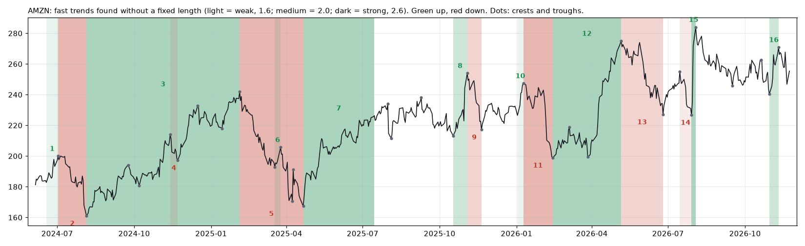
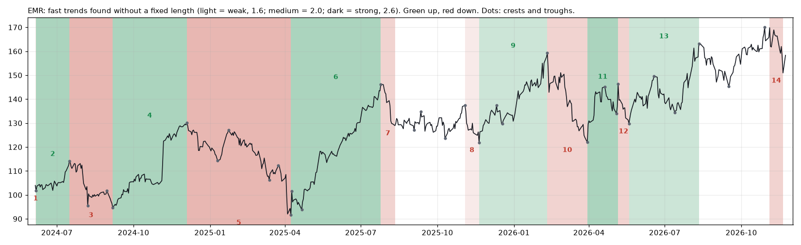
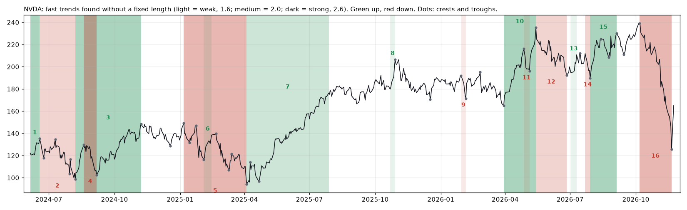
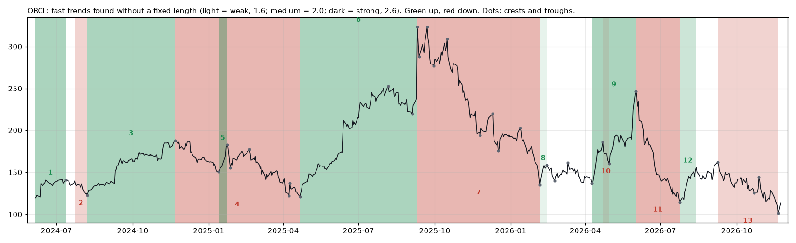
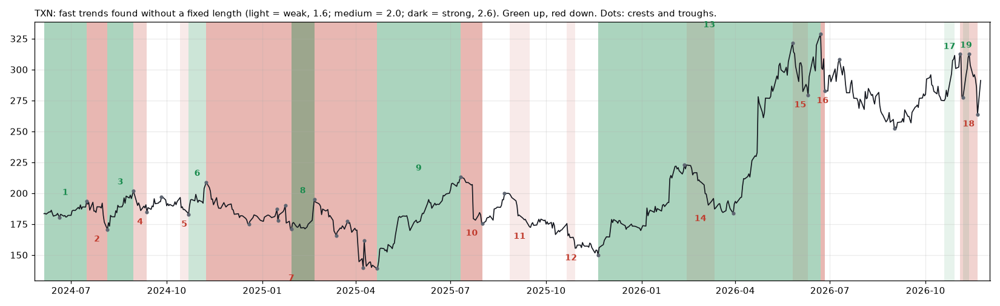

# Fast trends found without a fixed length: for the founder to mark

Step 1 of the addition and subtraction pool (`docs/POOL_PLAN.md`). No news is used here. For each stock: the chart of about the last two and a half years, each trend with a number, and the list under it. **To mark: say which numbers your eye does NOT accept as a trend, and where a trend you see is missing** (for example 'NVDA: 3 no; missing an uptrend in March'). 'Strength' = the move divided by how far the price drifts by chance in that many sessions; 'straightness' = the net move divided by the sum of all daily moves (1 = a straight line). 'First seen' = the first day on which the trend could have been recognised with the prices known that day.

## AAPL

| no. | direction | from | to | sessions | move | strength (tier) | straightness | first seen |
|---|---|---|---|---|---|---|---|---|
| 1 | up | 2024-04-19 | 2024-07-16 | 59 | +43% | 4.0 (strong) | 0.48 | 2024-04-29 |
| 2 | down | 2024-07-16 | 2024-08-06 | 15 | -12% | 2.3 (middle) | 0.65 | 2024-07-24 |
| 3 | up | 2024-09-16 | 2024-09-30 | 10 | +8% | 1.7 (weak) | 0.71 | 2024-09-30 |
| 4 | up | 2024-11-04 | 2024-12-26 | 36 | +17% | 1.9 (weak) | 0.56 | 2024-12-03 |
| 5 | down | 2024-12-26 | 2025-04-08 | 69 | -33% | 7.4 (strong) | 0.35 | 2025-01-02 |
| 6 | up | 2025-01-21 | 2025-02-24 | 23 | +11% | 2.2 (middle) | 0.40 | 2025-01-28 |
| 7 | up | 2025-04-08 | 2025-05-01 | 16 | +24% | 4.0 (strong) | 0.50 | 2025-04-14 |
| 8 | up | 2025-08-01 | 2025-10-29 | 62 | +33% | 2.9 (strong) | 0.39 | 2025-08-08 |
| 9 | up | 2026-01-20 | 2026-02-06 | 13 | +13% | 1.9 (weak) | 0.83 | 2026-02-02 |
| 10 | down | 2026-02-06 | 2026-02-13 | 5 | -8% | 1.9 (weak) | 0.86 | 2026-02-13 |
| 11 | up | 2026-03-30 | 2026-07-28 | 82 | +38% | 3.5 (strong) | 0.29 | 2026-05-05 |
| 12 | down | 2026-06-02 | 2026-06-25 | 16 | -13% | 2.6 (middle) | 0.55 | 2026-06-09 |
| 13 | down | 2026-07-28 | 2026-08-12 | 11 | -11% | 3.0 (strong) | 0.65 | 2026-07-31 |
| 14 | up | 2026-11-03 | 2026-11-13 | 8 | +7% | 1.8 (weak) | 0.56 | 2026-11-11 |

## AMD

| no. | direction | from | to | sessions | move | strength (tier) | straightness | first seen |
|---|---|---|---|---|---|---|---|---|
| 1 | up | 2024-06-18 | 2024-07-10 | 14 | +19% | 2.2 (middle) | 0.57 | 2024-07-08 |
| 2 | down | 2024-07-10 | 2024-08-07 | 20 | -30% | 3.3 (strong) | 0.64 | 2024-07-17 |
| 3 | up | 2024-08-07 | 2024-08-21 | 10 | +23% | 2.2 (middle) | 0.85 | 2024-08-15 |
| 4 | up | 2024-09-06 | 2024-10-08 | 22 | +29% | 1.9 (weak) | 0.61 | 2024-09-13 |
| 5 | down | 2024-10-08 | 2025-04-08 | 124 | -55% | 4.2 (strong) | 0.29 | 2024-11-04 |
| 6 | up | 2025-03-10 | 2025-03-25 | 11 | +19% | 2.0 (weak) | 0.66 | 2025-03-24 |
| 7 | up | 2025-04-08 | 2025-10-29 | 141 | +238% | 5.1 (strong) | 0.34 | 2025-04-14 |
| 8 | down | 2025-10-29 | 2025-11-21 | 17 | -23% | 2.6 (middle) | 0.43 | 2025-11-19 |
| 9 | up | 2026-01-09 | 2026-01-23 | 9 | +28% | 2.2 (middle) | 1.00 | 2026-01-16 |
| 10 | down | 2026-01-23 | 2026-03-03 | 26 | -26% | 3.3 (strong) | 0.37 | 2026-02-04 |
| 11 | up | 2026-03-03 | 2026-06-30 | 82 | +204% | 4.0 (strong) | 0.37 | 2026-04-08 |
| 12 | down | 2026-06-03 | 2026-06-10 | 5 | -17% | 2.0 (middle) | 0.64 | 2026-06-10 |
| 13 | down | 2026-06-30 | 2026-07-29 | 20 | -26% | 2.6 (strong) | 0.35 | 2026-07-28 |
| 14 | up | 2026-09-03 | 2026-10-06 | 22 | +42% | 2.2 (middle) | 0.57 | 2026-09-21 |
| 15 | down | 2026-10-06 | 2026-11-05 | 22 | -38% | 3.5 (strong) | 0.49 | 2026-10-16 |
| 16 | up | 2026-11-05 | 2026-11-12 | 5 | +45% | 3.7 (strong) | 1.00 | 2026-11-12 |

## AMZN

| no. | direction | from | to | sessions | move | strength (tier) | straightness | first seen |
|---|---|---|---|---|---|---|---|---|
| 1 | up | 2024-06-18 | 2024-07-02 | 9 | +9% | 1.9 (weak) | 0.52 | 2024-06-27 |
| 2 | down | 2024-07-02 | 2024-08-05 | 23 | -19% | 3.6 (strong) | 0.56 | 2024-07-18 |
| 3 | up | 2024-08-05 | 2025-02-04 | 125 | +50% | 3.2 (strong) | 0.24 | 2024-08-15 |
| 4 | down | 2024-11-13 | 2024-11-22 | 7 | -8% | 1.8 (weak) | 0.74 | 2024-11-21 |
| 5 | down | 2025-02-04 | 2025-04-21 | 52 | -31% | 3.7 (strong) | 0.33 | 2025-02-21 |
| 6 | up | 2025-03-18 | 2025-03-25 | 5 | +7% | 1.6 (weak) | 0.91 | 2025-03-25 |
| 7 | up | 2025-04-21 | 2025-07-15 | 58 | +35% | 2.8 (strong) | 0.39 | 2025-04-25 |
| 8 | up | 2025-10-17 | 2025-11-03 | 11 | +19% | 2.5 (middle) | 0.63 | 2025-10-31 |
| 9 | down | 2025-11-03 | 2025-11-20 | 13 | -15% | 2.4 (middle) | 0.73 | 2025-11-18 |
| 10 | up | 2026-01-02 | 2026-01-09 | 5 | +9% | 1.8 (weak) | 1.00 | 2026-01-09 |
| 11 | down | 2026-01-09 | 2026-02-13 | 24 | -20% | 3.2 (strong) | 0.56 | 2026-02-05 |
| 12 | up | 2026-02-13 | 2026-05-06 | 56 | +38% | 3.3 (strong) | 0.39 | 2026-04-08 |
| 13 | down | 2026-05-06 | 2026-06-25 | 34 | -17% | 2.5 (middle) | 0.34 | 2026-06-03 |
| 14 | down | 2026-07-15 | 2026-07-29 | 10 | -11% | 1.9 (weak) | 0.84 | 2026-07-23 |
| 15 | up | 2026-07-29 | 2026-08-03 | 3 | +25% | 4.6 (strong) | 1.00 | 2026-07-31 |
| 16 | up | 2026-10-30 | 2026-11-10 | 7 | +13% | 2.2 (middle) | 0.70 | 2026-11-06 |

## AVGO

| no. | direction | from | to | sessions | move | strength (tier) | straightness | first seen |
|---|---|---|---|---|---|---|---|---|
| 1 | up | 2023-09-21 | 2024-06-17 | 185 | +128% | 4.9 (strong) | 0.25 | 2023-10-12 |
| 2 | down | 2024-06-17 | 2024-08-07 | 35 | -25% | 2.9 (strong) | 0.30 | 2024-06-24 |
| 3 | up | 2024-08-07 | 2024-12-16 | 91 | +84% | 5.3 (strong) | 0.28 | 2024-08-14 |
| 4 | down | 2024-11-08 | 2024-11-15 | 5 | -10% | 1.7 (weak) | 1.00 | 2024-11-15 |
| 5 | down | 2025-01-24 | 2025-04-04 | 49 | -40% | 2.5 (middle) | 0.33 | 2025-01-27 |
| 6 | up | 2025-04-04 | 2025-07-21 | 72 | +97% | 2.6 (strong) | 0.45 | 2025-04-11 |
| 7 | up | 2025-08-21 | 2025-09-10 | 13 | +28% | 2.5 (middle) | 0.66 | 2025-09-08 |
| 8 | up | 2025-11-21 | 2025-11-28 | 4 | +18% | 1.9 (weak) | 1.00 | 2025-11-26 |
| 9 | down | 2025-12-10 | 2025-12-17 | 5 | -21% | 2.9 (strong) | 0.96 | 2025-12-15 |
| 10 | up | 2026-03-30 | 2026-06-02 | 44 | +64% | 3.0 (strong) | 0.51 | 2026-04-07 |
| 11 | down | 2026-06-02 | 2026-07-02 | 21 | -25% | 4.2 (strong) | 0.39 | 2026-06-05 |
| 12 | up | 2026-07-29 | 2026-08-07 | 7 | +16% | 1.8 (weak) | 1.00 | 2026-08-05 |
| 13 | down | 2026-08-07 | 2026-08-26 | 13 | -17% | 2.0 (middle) | 0.82 | 2026-08-19 |
| 14 | down | 2026-10-07 | 2026-11-05 | 21 | -23% | 2.6 (strong) | 0.45 | 2026-10-16 |
| 15 | up | 2026-11-05 | 2026-11-12 | 5 | +25% | 3.3 (strong) | 1.00 | 2026-11-12 |
| 16 | down | 2026-11-12 | 2026-11-20 | 6 | -16% | 2.4 (middle) | 0.60 | 2026-11-20 |

## CRWD

| no. | direction | from | to | sessions | move | strength (tier) | straightness | first seen |
|---|---|---|---|---|---|---|---|---|
| 1 | up | 2024-04-19 | 2024-07-01 | 49 | +39% | 4.0 (strong) | 0.34 | 2024-05-15 |
| 2 | down | 2024-07-01 | 2024-08-02 | 23 | -44% | 6.1 (strong) | 0.81 | 2024-07-18 |
| 3 | up | 2024-08-02 | 2024-12-16 | 94 | +78% | 2.3 (middle) | 0.31 | 2024-08-13 |
| 4 | up | 2025-01-13 | 2025-02-18 | 24 | +33% | 2.0 (middle) | 0.69 | 2025-01-28 |
| 5 | down | 2025-02-18 | 2025-03-10 | 14 | -32% | 3.5 (strong) | 0.70 | 2025-02-21 |
| 6 | up | 2025-03-10 | 2025-07-03 | 80 | +66% | 2.7 (strong) | 0.25 | 2025-03-17 |
| 7 | up | 2025-09-04 | 2025-09-18 | 10 | +22% | 2.4 (middle) | 0.90 | 2025-09-18 |
| 8 | down | 2025-11-10 | 2026-02-24 | 71 | -37% | 3.2 (strong) | 0.32 | 2026-02-03 |
| 9 | up | 2026-02-05 | 2026-02-13 | 6 | +14% | 1.9 (weak) | 0.86 | 2026-02-13 |
| 10 | up | 2026-02-24 | 2026-10-06 | 155 | +218% | 4.7 (strong) | 0.27 | 2026-03-03 |
| 11 | down | 2026-03-11 | 2026-03-27 | 12 | -16% | 2.2 (middle) | 0.61 | 2026-03-25 |
| 12 | down | 2026-06-01 | 2026-06-09 | 6 | -18% | 2.8 (strong) | 1.00 | 2026-06-08 |
| 13 | down | 2026-07-14 | 2026-07-29 | 11 | -15% | 1.8 (weak) | 0.90 | 2026-07-23 |
| 14 | down | 2026-08-13 | 2026-08-25 | 8 | -18% | 2.5 (middle) | 0.92 | 2026-08-20 |
| 15 | down | 2026-10-06 | 2026-10-20 | 10 | -18% | 2.5 (middle) | 0.68 | 2026-10-16 |
| 16 | down | 2026-10-27 | 2026-11-23 | 19 | -22% | 2.4 (middle) | 0.40 | 2026-11-05 |

## CSCO

| no. | direction | from | to | sessions | move | strength (tier) | straightness | first seen |
|---|---|---|---|---|---|---|---|---|
| 1 | down | 2024-05-15 | 2024-06-13 | 20 | -8% | 2.2 (middle) | 0.50 | 2024-05-22 |
| 2 | down | 2024-07-17 | 2024-08-05 | 13 | -8% | 2.7 (strong) | 0.48 | 2024-08-05 |
| 3 | up | 2024-08-05 | 2024-12-05 | 86 | +35% | 3.9 (strong) | 0.42 | 2024-08-15 |
| 4 | up | 2024-12-18 | 2025-02-14 | 38 | +14% | 2.1 (middle) | 0.41 | 2024-12-26 |
| 5 | down | 2025-02-14 | 2025-04-08 | 36 | -17% | 5.4 (strong) | 0.45 | 2025-03-11 |
| 6 | up | 2025-04-08 | 2025-07-03 | 59 | +31% | 2.9 (strong) | 0.42 | 2025-04-11 |
| 7 | up | 2025-08-01 | 2025-08-08 | 5 | +7% | 2.1 (middle) | 0.70 | 2025-08-08 |
| 8 | down | 2025-08-08 | 2025-08-15 | 5 | -8% | 2.5 (middle) | 0.80 | 2025-08-15 |
| 9 | up | 2025-09-12 | 2026-06-04 | 182 | +99% | 6.2 (strong) | 0.27 | 2025-11-03 |
| 10 | down | 2025-12-10 | 2025-12-17 | 5 | -5% | 1.6 (weak) | 0.83 | 2025-12-17 |
| 11 | down | 2026-02-09 | 2026-02-12 | 3 | -14% | 3.6 (strong) | 1.00 | 2026-02-12 |
| 12 | down | 2026-06-04 | 2026-07-16 | 28 | -15% | 1.8 (weak) | 0.28 | 2026-06-10 |
| 13 | down | 2026-08-12 | 2026-08-20 | 6 | -12% | 2.4 (middle) | 0.85 | 2026-08-14 |
| 14 | up | 2026-09-23 | 2026-10-09 | 12 | +12% | 2.1 (middle) | 0.66 | 2026-10-06 |
| 15 | down | 2026-10-09 | 2026-11-20 | 30 | -23% | 2.7 (strong) | 0.40 | 2026-10-16 |

## EMR

| no. | direction | from | to | sessions | move | strength (tier) | straightness | first seen |
|---|---|---|---|---|---|---|---|---|
| 1 | down | 2024-05-22 | 2024-06-06 | 10 | -8% | 1.8 (weak) | 0.55 | 2024-06-04 |
| 2 | up | 2024-06-06 | 2024-07-16 | 26 | +12% | 2.7 (strong) | 0.39 | 2024-07-11 |
| 3 | down | 2024-07-16 | 2024-09-06 | 37 | -17% | 5.2 (strong) | 0.34 | 2024-08-02 |
| 4 | up | 2024-09-06 | 2024-12-04 | 62 | +37% | 4.6 (strong) | 0.48 | 2024-09-19 |
| 5 | down | 2024-12-04 | 2025-04-08 | 84 | -30% | 4.3 (strong) | 0.29 | 2024-12-18 |
| 6 | up | 2025-04-08 | 2025-07-25 | 74 | +60% | 2.9 (strong) | 0.48 | 2025-04-24 |
| 7 | down | 2025-07-25 | 2025-08-11 | 11 | -12% | 2.1 (middle) | 0.91 | 2025-08-06 |
| 8 | down | 2025-11-03 | 2025-11-20 | 13 | -11% | 1.7 (weak) | 0.62 | 2025-11-07 |
| 9 | up | 2025-11-20 | 2026-02-10 | 54 | +31% | 2.0 (middle) | 0.34 | 2025-11-28 |
| 10 | down | 2026-02-10 | 2026-03-30 | 33 | -23% | 2.4 (middle) | 0.44 | 2026-02-12 |
| 11 | up | 2026-03-30 | 2026-05-06 | 26 | +20% | 2.9 (strong) | 0.38 | 2026-04-07 |
| 12 | down | 2026-05-06 | 2026-05-19 | 9 | -11% | 2.1 (middle) | 0.91 | 2026-05-13 |
| 13 | up | 2026-05-19 | 2026-08-11 | 57 | +26% | 2.5 (middle) | 0.24 | 2026-05-27 |
| 14 | down | 2026-11-04 | 2026-11-20 | 12 | -11% | 2.2 (middle) | 0.49 | 2026-11-20 |

## GE

| no. | direction | from | to | sessions | move | strength (tier) | straightness | first seen |
|---|---|---|---|---|---|---|---|---|
| 1 | up | 2024-07-17 | 2024-10-21 | 67 | +24% | 2.7 (strong) | 0.24 | 2024-07-23 |
| 2 | down | 2024-07-23 | 2024-08-05 | 9 | -8% | 1.8 (weak) | 0.40 | 2024-08-05 |
| 3 | down | 2024-08-30 | 2024-09-06 | 4 | -8% | 1.9 (weak) | 0.75 | 2024-09-06 |
| 4 | down | 2024-10-21 | 2024-12-18 | 41 | -18% | 2.6 (middle) | 0.31 | 2024-10-22 |
| 5 | up | 2024-11-01 | 2024-11-08 | 5 | +8% | 1.8 (weak) | 0.78 | 2024-11-08 |
| 6 | up | 2024-12-18 | 2025-08-04 | 154 | +74% | 3.1 (strong) | 0.24 | 2024-12-26 |
| 7 | down | 2025-03-25 | 2025-04-04 | 8 | -21% | 4.3 (strong) | 0.86 | 2025-04-03 |
| 8 | up | 2025-12-10 | 2026-01-06 | 17 | +16% | 1.9 (weak) | 0.56 | 2025-12-22 |
| 9 | down | 2026-01-06 | 2026-01-28 | 15 | -11% | 2.2 (middle) | 0.38 | 2026-01-22 |
| 10 | up | 2026-01-28 | 2026-03-02 | 22 | +18% | 2.1 (middle) | 0.57 | 2026-02-06 |
| 11 | down | 2026-03-02 | 2026-03-30 | 20 | -21% | 3.1 (strong) | 0.59 | 2026-03-12 |
| 12 | up | 2026-03-30 | 2026-08-05 | 88 | +40% | 2.7 (strong) | 0.21 | 2026-04-08 |
| 13 | down | 2026-05-06 | 2026-05-15 | 7 | -8% | 1.6 (weak) | 0.77 | 2026-05-15 |
| 14 | down | 2026-07-06 | 2026-07-21 | 11 | -10% | 1.7 (weak) | 0.59 | 2026-07-16 |
| 15 | down | 2026-08-05 | 2026-10-23 | 56 | -25% | 2.3 (middle) | 0.39 | 2026-08-24 |
| 16 | up | 2026-10-23 | 2026-11-11 | 13 | +20% | 2.4 (middle) | 0.53 | 2026-11-02 |
| 17 | down | 2026-11-11 | 2026-11-20 | 7 | -10% | 1.8 (weak) | 0.81 | 2026-11-20 |

## GOOG

| no. | direction | from | to | sessions | move | strength (tier) | straightness | first seen |
|---|---|---|---|---|---|---|---|---|
| 1 | up | 2024-03-06 | 2024-07-10 | 86 | +46% | 2.8 (strong) | 0.37 | 2024-03-14 |
| 2 | down | 2024-07-10 | 2024-09-09 | 42 | -22% | 2.6 (middle) | 0.42 | 2024-07-18 |
| 3 | up | 2024-09-09 | 2025-02-04 | 101 | +39% | 3.1 (strong) | 0.25 | 2024-09-17 |
| 4 | down | 2024-11-12 | 2024-11-22 | 8 | -9% | 2.0 (middle) | 0.60 | 2024-11-21 |
| 5 | down | 2025-02-04 | 2025-04-08 | 44 | -29% | 3.1 (strong) | 0.45 | 2025-02-07 |
| 6 | up | 2025-04-08 | 2026-01-13 | 192 | +130% | 3.0 (strong) | 0.31 | 2025-04-11 |
| 7 | down | 2025-12-10 | 2025-12-17 | 5 | -7% | 1.6 (weak) | 1.00 | 2025-12-17 |
| 8 | down | 2026-02-02 | 2026-03-30 | 39 | -21% | 2.4 (middle) | 0.48 | 2026-02-10 |
| 9 | up | 2026-03-30 | 2026-05-13 | 31 | +46% | 3.9 (strong) | 0.70 | 2026-04-06 |
| 10 | down | 2026-05-13 | 2026-07-23 | 48 | -20% | 3.3 (strong) | 0.29 | 2026-06-02 |
| 11 | up | 2026-06-26 | 2026-07-15 | 12 | +11% | 2.1 (middle) | 0.53 | 2026-07-06 |
| 12 | up | 2026-07-23 | 2026-08-04 | 8 | +18% | 3.3 (strong) | 0.93 | 2026-07-31 |
| 13 | down | 2026-08-04 | 2026-11-20 | 77 | -30% | 3.5 (strong) | 0.33 | 2026-08-11 |

## IBM

| no. | direction | from | to | sessions | move | strength (tier) | straightness | first seen |
|---|---|---|---|---|---|---|---|---|
| 1 | up | 2024-05-01 | 2024-10-14 | 114 | +46% | 2.8 (strong) | 0.40 | 2024-07-12 |
| 2 | down | 2024-10-14 | 2024-10-30 | 12 | -13% | 4.2 (strong) | 0.90 | 2024-10-24 |
| 3 | up | 2024-10-30 | 2025-02-20 | 75 | +31% | 5.3 (strong) | 0.32 | 2024-11-21 |
| 4 | down | 2024-12-06 | 2024-12-18 | 8 | -8% | 1.9 (weak) | 0.70 | 2024-12-18 |
| 5 | down | 2025-02-20 | 2025-04-08 | 33 | -17% | 3.5 (strong) | 0.35 | 2025-04-04 |
| 6 | up | 2025-04-08 | 2025-06-30 | 56 | +34% | 2.4 (middle) | 0.39 | 2025-04-15 |
| 7 | down | 2025-06-30 | 2025-08-12 | 30 | -20% | 2.7 (strong) | 0.65 | 2025-07-24 |
| 8 | up | 2025-08-12 | 2025-11-12 | 65 | +35% | 2.5 (middle) | 0.36 | 2025-09-09 |
| 9 | down | 2025-11-12 | 2025-11-19 | 5 | -8% | 2.1 (middle) | 0.94 | 2025-11-18 |
| 10 | down | 2026-02-02 | 2026-05-13 | 70 | -31% | 5.0 (strong) | 0.27 | 2026-02-11 |
| 11 | up | 2026-05-13 | 2026-06-02 | 13 | +53% | 6.4 (strong) | 0.94 | 2026-05-21 |
| 12 | down | 2026-06-02 | 2026-07-22 | 34 | -37% | 6.2 (strong) | 0.44 | 2026-06-08 |

## INTC

| no. | direction | from | to | sessions | move | strength (tier) | straightness | first seen |
|---|---|---|---|---|---|---|---|---|
| 1 | down | 2024-01-25 | 2024-09-06 | 155 | -61% | 8.9 (strong) | 0.27 | 2024-01-26 |
| 2 | up | 2024-06-26 | 2024-07-10 | 9 | +14% | 2.2 (middle) | 0.94 | 2024-07-08 |
| 3 | up | 2024-09-06 | 2024-09-26 | 14 | +27% | 2.0 (middle) | 0.69 | 2024-09-17 |
| 4 | up | 2024-10-31 | 2024-11-07 | 5 | +22% | 2.7 (strong) | 0.77 | 2024-11-07 |
| 5 | down | 2024-11-07 | 2024-12-19 | 29 | -27% | 2.1 (middle) | 0.49 | 2024-12-05 |
| 6 | up | 2024-12-19 | 2025-02-18 | 38 | +44% | 4.4 (strong) | 0.38 | 2025-01-21 |
| 7 | down | 2025-02-18 | 2025-04-08 | 35 | -34% | 2.5 (middle) | 0.35 | 2025-02-25 |
| 8 | down | 2025-07-23 | 2025-08-01 | 7 | -18% | 1.8 (weak) | 1.00 | 2025-07-31 |
| 9 | up | 2025-08-01 | 2026-06-22 | 222 | +630% | 5.2 (strong) | 0.26 | 2025-08-14 |
| 10 | down | 2026-05-11 | 2026-05-18 | 5 | -16% | 1.8 (weak) | 1.00 | 2026-05-18 |
| 11 | down | 2026-05-26 | 2026-06-05 | 8 | -20% | 1.8 (weak) | 0.72 | 2026-06-05 |
| 12 | down | 2026-06-22 | 2026-11-20 | 107 | -64% | 5.2 (strong) | 0.24 | 2026-07-07 |
| 13 | up | 2026-07-29 | 2026-08-07 | 7 | +24% | 1.9 (weak) | 0.83 | 2026-08-05 |
| 14 | up | 2026-08-24 | 2026-09-24 | 22 | +46% | 2.2 (middle) | 0.54 | 2026-09-09 |

## META

| no. | direction | from | to | sessions | move | strength (tier) | straightness | first seen |
|---|---|---|---|---|---|---|---|---|
| 1 | down | 2024-07-05 | 2024-07-25 | 14 | -16% | 2.9 (strong) | 0.57 | 2024-07-16 |
| 2 | up | 2024-07-25 | 2024-10-04 | 50 | +32% | 1.9 (weak) | 0.42 | 2024-08-01 |
| 3 | up | 2024-11-15 | 2025-02-14 | 60 | +33% | 2.0 (middle) | 0.37 | 2024-12-03 |
| 4 | down | 2025-02-14 | 2025-04-21 | 44 | -34% | 3.8 (strong) | 0.36 | 2025-02-24 |
| 5 | up | 2025-03-18 | 2025-03-25 | 5 | +8% | 1.6 (weak) | 1.00 | 2025-03-25 |
| 6 | up | 2025-04-21 | 2025-06-30 | 48 | +52% | 3.2 (strong) | 0.55 | 2025-04-25 |
| 7 | up | 2025-07-30 | 2025-08-12 | 9 | +14% | 2.1 (middle) | 0.49 | 2025-08-05 |
| 8 | down | 2025-09-18 | 2025-11-20 | 45 | -24% | 3.5 (strong) | 0.45 | 2025-10-30 |
| 9 | up | 2025-11-20 | 2025-12-05 | 10 | +14% | 1.8 (weak) | 0.71 | 2025-11-28 |
| 10 | up | 2026-01-20 | 2026-01-29 | 7 | +22% | 3.2 (strong) | 0.94 | 2026-01-27 |
| 11 | down | 2026-01-29 | 2026-03-27 | 40 | -29% | 2.6 (middle) | 0.50 | 2026-02-05 |
| 12 | up | 2026-03-27 | 2026-04-17 | 14 | +31% | 2.9 (strong) | 0.93 | 2026-04-08 |
| 13 | down | 2026-04-17 | 2026-05-11 | 16 | -13% | 2.1 (middle) | 0.54 | 2026-04-30 |
| 14 | down | 2026-05-28 | 2026-06-25 | 19 | -14% | 2.0 (weak) | 0.39 | 2026-06-10 |
| 15 | down | 2026-07-15 | 2026-07-30 | 11 | -21% | 2.9 (strong) | 1.00 | 2026-07-23 |
| 16 | up | 2026-07-30 | 2026-09-24 | 39 | +44% | 3.0 (strong) | 0.48 | 2026-08-06 |
| 17 | down | 2026-09-24 | 2026-11-20 | 41 | -28% | 2.5 (middle) | 0.38 | 2026-10-22 |

## MSFT

| no. | direction | from | to | sessions | move | strength (tier) | straightness | first seen |
|---|---|---|---|---|---|---|---|---|
| 1 | up | 2024-04-30 | 2024-07-05 | 45 | +20% | 2.1 (middle) | 0.50 | 2024-05-07 |
| 2 | down | 2024-07-05 | 2024-08-05 | 21 | -15% | 3.2 (strong) | 0.62 | 2024-07-17 |
| 3 | up | 2024-08-05 | 2024-08-20 | 11 | +8% | 1.8 (weak) | 0.80 | 2024-08-14 |
| 4 | up | 2024-09-06 | 2024-09-19 | 9 | +9% | 2.5 (middle) | 0.81 | 2024-09-13 |
| 5 | down | 2024-09-30 | 2024-10-07 | 5 | -5% | 1.8 (weak) | 1.00 | 2024-10-07 |
| 6 | up | 2024-10-31 | 2024-12-17 | 32 | +12% | 1.9 (weak) | 0.41 | 2024-11-07 |
| 7 | down | 2024-12-17 | 2025-04-08 | 75 | -22% | 2.8 (strong) | 0.28 | 2024-12-27 |
| 8 | up | 2025-01-14 | 2025-01-28 | 9 | +8% | 2.5 (middle) | 0.53 | 2025-01-22 |
| 9 | up | 2025-04-08 | 2025-08-04 | 80 | +51% | 4.1 (strong) | 0.48 | 2025-04-11 |
| 10 | down | 2025-10-28 | 2026-03-27 | 103 | -34% | 5.4 (strong) | 0.32 | 2025-11-05 |
| 11 | up | 2026-01-21 | 2026-01-28 | 5 | +8% | 2.4 (middle) | 1.00 | 2026-01-27 |
| 12 | down | 2026-06-01 | 2026-06-25 | 17 | -23% | 4.1 (strong) | 0.75 | 2026-06-05 |
| 13 | up | 2026-06-25 | 2026-10-13 | 76 | +54% | 5.7 (strong) | 0.38 | 2026-07-02 |
| 14 | down | 2026-11-04 | 2026-11-20 | 12 | -13% | 1.9 (weak) | 0.65 | 2026-11-20 |

## MU

| no. | direction | from | to | sessions | move | strength (tier) | straightness | first seen |
|---|---|---|---|---|---|---|---|---|
| 1 | up | 2023-10-26 | 2024-06-18 | 161 | +138% | 4.7 (strong) | 0.28 | 2023-11-02 |
| 2 | down | 2024-06-18 | 2024-09-09 | 56 | -44% | 4.2 (strong) | 0.38 | 2024-06-27 |
| 3 | up | 2024-08-07 | 2024-08-19 | 8 | +25% | 3.2 (strong) | 1.00 | 2024-08-14 |
| 4 | up | 2024-09-09 | 2024-10-17 | 28 | +30% | 3.4 (strong) | 0.35 | 2024-09-26 |
| 5 | up | 2024-10-31 | 2024-11-07 | 5 | +14% | 1.9 (weak) | 1.00 | 2024-11-07 |
| 6 | down | 2024-11-07 | 2024-12-31 | 36 | -26% | 2.8 (strong) | 0.31 | 2024-11-13 |
| 7 | up | 2024-12-31 | 2025-01-21 | 12 | +30% | 2.4 (middle) | 0.64 | 2025-01-07 |
| 8 | down | 2025-01-21 | 2025-04-04 | 52 | -41% | 3.9 (strong) | 0.28 | 2025-01-27 |
| 9 | up | 2025-02-12 | 2025-02-18 | 3 | +16% | 1.7 (weak) | 1.00 | 2025-02-18 |
| 10 | up | 2025-03-10 | 2025-03-17 | 5 | +18% | 2.1 (middle) | 0.91 | 2025-03-17 |
| 11 | up | 2025-04-04 | 2026-06-25 | 306 | +1780% | 4.4 (strong) | 0.28 | 2025-04-25 |
| 12 | down | 2025-11-10 | 2025-11-20 | 8 | -21% | 2.1 (middle) | 0.67 | 2025-11-20 |
| 13 | down | 2025-12-10 | 2025-12-17 | 5 | -14% | 1.7 (weak) | 1.00 | 2025-12-17 |
| 14 | down | 2026-02-02 | 2026-02-10 | 6 | -15% | 1.6 (weak) | 0.67 | 2026-02-10 |
| 15 | down | 2026-03-18 | 2026-03-30 | 8 | -30% | 3.2 (strong) | 0.97 | 2026-03-24 |
| 16 | down | 2026-05-13 | 2026-05-18 | 3 | -15% | 1.8 (weak) | 1.00 | 2026-05-18 |
| 17 | down | 2026-06-25 | 2026-07-29 | 23 | -39% | 2.4 (middle) | 0.45 | 2026-07-02 |
| 18 | up | 2026-07-29 | 2026-08-17 | 13 | +37% | 1.8 (weak) | 0.62 | 2026-08-05 |
| 19 | down | 2026-10-01 | 2026-11-20 | 36 | -46% | 3.2 (strong) | 0.38 | 2026-11-04 |
| 20 | up | 2026-11-05 | 2026-11-11 | 4 | +24% | 1.7 (weak) | 0.91 | 2026-11-12 |

## NVDA

| no. | direction | from | to | sessions | move | strength (tier) | straightness | first seen |
|---|---|---|---|---|---|---|---|---|
| 1 | up | 2023-10-26 | 2024-06-18 | 161 | +236% | 3.4 (strong) | 0.35 | 2023-11-07 |
| 2 | down | 2024-06-18 | 2024-08-07 | 34 | -27% | 2.6 (middle) | 0.26 | 2024-06-24 |
| 3 | up | 2024-08-07 | 2024-11-07 | 65 | +51% | 3.1 (strong) | 0.25 | 2024-08-13 |
| 4 | down | 2024-08-19 | 2024-09-06 | 13 | -21% | 2.7 (strong) | 0.56 | 2024-09-03 |
| 5 | down | 2025-01-06 | 2025-04-04 | 61 | -37% | 2.6 (strong) | 0.23 | 2025-01-14 |
| 6 | up | 2025-02-03 | 2025-02-14 | 9 | +19% | 1.7 (weak) | 0.83 | 2025-02-10 |
| 7 | up | 2025-04-04 | 2025-07-28 | 77 | +87% | 2.1 (middle) | 0.40 | 2025-04-11 |
| 8 | up | 2025-10-22 | 2025-10-29 | 5 | +15% | 2.0 (weak) | 1.00 | 2025-10-29 |
| 9 | down | 2026-01-29 | 2026-02-05 | 5 | -11% | 1.8 (weak) | 1.00 | 2026-02-05 |
| 10 | up | 2026-03-30 | 2026-05-14 | 32 | +43% | 3.2 (strong) | 0.59 | 2026-04-10 |
| 11 | down | 2026-04-27 | 2026-05-05 | 6 | -9% | 1.9 (weak) | 1.00 | 2026-05-04 |
| 12 | down | 2026-05-14 | 2026-06-26 | 29 | -18% | 2.0 (middle) | 0.33 | 2026-05-22 |
| 13 | up | 2026-07-02 | 2026-07-10 | 5 | +8% | 1.6 (weak) | 0.86 | 2026-07-10 |
| 14 | down | 2026-07-22 | 2026-07-29 | 5 | -10% | 2.2 (middle) | 0.96 | 2026-07-29 |
| 15 | up | 2026-07-29 | 2026-09-04 | 27 | +21% | 2.8 (strong) | 0.34 | 2026-08-05 |
| 16 | down | 2026-10-06 | 2026-11-20 | 33 | -48% | 5.9 (strong) | 0.67 | 2026-10-16 |

## ORCL

| no. | direction | from | to | sessions | move | strength (tier) | straightness | first seen |
|---|---|---|---|---|---|---|---|---|
| 1 | up | 2024-04-30 | 2024-07-12 | 50 | +28% | 3.4 (strong) | 0.38 | 2024-06-12 |
| 2 | down | 2024-07-23 | 2024-08-07 | 11 | -12% | 2.1 (middle) | 0.62 | 2024-08-05 |
| 3 | up | 2024-08-07 | 2024-11-21 | 75 | +53% | 4.1 (strong) | 0.44 | 2024-09-10 |
| 4 | down | 2024-11-21 | 2025-04-21 | 100 | -36% | 2.8 (strong) | 0.19 | 2024-12-13 |
| 5 | up | 2025-01-13 | 2025-01-23 | 7 | +21% | 3.6 (strong) | 1.00 | 2025-01-21 |
| 6 | up | 2025-04-21 | 2025-09-10 | 98 | +168% | 6.1 (strong) | 0.48 | 2025-04-28 |
| 7 | down | 2025-09-10 | 2026-02-05 | 102 | -58% | 2.9 (strong) | 0.32 | 2025-09-29 |
| 8 | up | 2026-02-05 | 2026-02-13 | 6 | +17% | 1.8 (weak) | 0.79 | 2026-02-12 |
| 9 | up | 2026-04-09 | 2026-06-01 | 36 | +80% | 3.2 (strong) | 0.49 | 2026-04-14 |
| 10 | down | 2026-04-22 | 2026-04-30 | 6 | -14% | 1.7 (weak) | 1.00 | 2026-04-29 |
| 11 | down | 2026-06-01 | 2026-07-24 | 37 | -53% | 3.3 (strong) | 0.63 | 2026-06-08 |
| 12 | up | 2026-07-24 | 2026-08-13 | 14 | +36% | 2.3 (middle) | 0.68 | 2026-08-03 |
| 13 | down | 2026-09-08 | 2026-11-20 | 53 | -38% | 2.5 (middle) | 0.27 | 2026-09-15 |

## QCOM

| no. | direction | from | to | sessions | move | strength (tier) | straightness | first seen |
|---|---|---|---|---|---|---|---|---|
| 1 | up | 2023-10-25 | 2024-06-18 | 162 | +120% | 3.2 (strong) | 0.34 | 2023-11-02 |
| 2 | down | 2024-06-18 | 2024-08-07 | 34 | -31% | 3.8 (strong) | 0.40 | 2024-06-24 |
| 3 | up | 2024-08-07 | 2024-08-19 | 8 | +12% | 1.9 (weak) | 0.62 | 2024-08-15 |
| 4 | down | 2024-11-07 | 2024-11-20 | 9 | -11% | 1.6 (weak) | 0.54 | 2024-11-20 |
| 5 | up | 2025-01-13 | 2025-01-23 | 7 | +11% | 1.6 (weak) | 0.74 | 2025-01-23 |
| 6 | down | 2025-02-05 | 2025-04-08 | 43 | -29% | 3.8 (strong) | 0.41 | 2025-02-27 |
| 7 | up | 2025-04-08 | 2025-05-14 | 25 | +23% | 2.0 (weak) | 0.33 | 2025-04-15 |
| 8 | down | 2025-07-29 | 2025-08-06 | 6 | -10% | 1.7 (weak) | 0.84 | 2025-08-05 |
| 9 | down | 2025-10-03 | 2025-10-10 | 5 | -9% | 1.9 (weak) | 0.78 | 2025-10-10 |
| 10 | up | 2025-10-10 | 2025-10-27 | 11 | +22% | 2.6 (middle) | 0.90 | 2025-10-27 |
| 11 | down | 2025-11-12 | 2025-11-20 | 6 | -10% | 1.7 (weak) | 0.89 | 2025-11-20 |
| 12 | down | 2026-01-06 | 2026-04-07 | 62 | -32% | 2.7 (strong) | 0.43 | 2026-01-13 |
| 13 | up | 2026-04-07 | 2026-05-29 | 37 | +102% | 8.2 (strong) | 0.48 | 2026-04-24 |
| 14 | down | 2026-05-29 | 2026-07-31 | 43 | -41% | 4.1 (strong) | 0.35 | 2026-06-05 |
| 15 | up | 2026-07-31 | 2026-08-07 | 5 | +14% | 1.8 (weak) | 0.67 | 2026-08-07 |
| 16 | up | 2026-09-18 | 2026-09-25 | 5 | +14% | 1.7 (weak) | 0.76 | 2026-09-25 |
| 17 | down | 2026-10-29 | 2026-11-05 | 5 | -15% | 2.3 (middle) | 0.56 | 2026-11-05 |
| 18 | down | 2026-11-12 | 2026-11-20 | 6 | -15% | 2.0 (weak) | 0.86 | 2026-11-20 |

## SNDK

| no. | direction | from | to | sessions | move | strength (tier) | straightness | first seen |
|---|---|---|---|---|---|---|---|---|
| 1 | up | 2025-08-07 | 2026-06-25 | 221 | +5639% | 4.6 (strong) | 0.35 | 2025-09-04 |
| 2 | down | 2025-11-12 | 2025-12-03 | 14 | -31% | 2.6 (strong) | 0.40 | 2025-11-20 |
| 3 | down | 2026-02-03 | 2026-02-10 | 5 | -22% | 1.8 (weak) | 0.77 | 2026-02-10 |
| 4 | down | 2026-03-19 | 2026-03-30 | 7 | -26% | 1.8 (weak) | 0.88 | 2026-03-26 |
| 5 | down | 2026-06-25 | 2026-07-29 | 23 | -56% | 3.0 (strong) | 0.46 | 2026-07-02 |
| 6 | up | 2026-07-29 | 2026-08-17 | 13 | +76% | 2.3 (middle) | 0.57 | 2026-08-04 |
| 7 | down | 2026-09-22 | 2026-11-20 | 43 | -66% | 3.3 (strong) | 0.50 | 2026-11-04 |

## TSM

| no. | direction | from | to | sessions | move | strength (tier) | straightness | first seen |
|---|---|---|---|---|---|---|---|---|
| 1 | up | 2023-10-27 | 2024-07-10 | 174 | +125% | 3.8 (strong) | 0.29 | 2023-11-10 |
| 2 | down | 2024-07-10 | 2024-08-05 | 18 | -23% | 3.1 (strong) | 0.49 | 2024-07-17 |
| 3 | up | 2024-08-05 | 2024-10-17 | 52 | +40% | 2.8 (strong) | 0.32 | 2024-08-09 |
| 4 | up | 2024-11-27 | 2024-12-05 | 5 | +13% | 2.2 (middle) | 1.00 | 2024-12-05 |
| 5 | up | 2025-01-13 | 2025-01-23 | 7 | +12% | 1.8 (weak) | 0.78 | 2025-01-22 |
| 6 | down | 2025-01-23 | 2025-04-08 | 52 | -37% | 2.9 (strong) | 0.36 | 2025-01-27 |
| 7 | up | 2025-04-08 | 2025-07-17 | 68 | +74% | 2.4 (middle) | 0.44 | 2025-04-15 |
| 8 | up | 2025-08-21 | 2025-10-29 | 48 | +35% | 2.1 (middle) | 0.33 | 2025-09-10 |
| 9 | down | 2025-12-10 | 2025-12-17 | 5 | -10% | 1.9 (weak) | 1.00 | 2025-12-17 |
| 10 | up | 2025-12-17 | 2026-02-25 | 46 | +40% | 2.6 (middle) | 0.42 | 2026-01-02 |
| 11 | down | 2026-02-25 | 2026-03-30 | 23 | -18% | 2.1 (middle) | 0.40 | 2026-03-03 |
| 12 | up | 2026-03-30 | 2026-06-30 | 63 | +51% | 2.5 (middle) | 0.28 | 2026-04-07 |
| 13 | down | 2026-06-02 | 2026-06-10 | 6 | -8% | 1.6 (weak) | 0.48 | 2026-06-10 |
| 14 | down | 2026-06-30 | 2026-07-29 | 20 | -22% | 2.2 (middle) | 0.52 | 2026-07-08 |
| 15 | up | 2026-07-29 | 2026-08-13 | 11 | +15% | 1.8 (weak) | 0.86 | 2026-08-05 |
| 16 | up | 2026-09-15 | 2026-10-05 | 14 | +18% | 1.7 (weak) | 0.85 | 2026-09-22 |
| 17 | down | 2026-10-05 | 2026-11-20 | 34 | -34% | 3.8 (strong) | 0.42 | 2026-10-14 |
| 18 | up | 2026-11-05 | 2026-11-11 | 4 | +17% | 2.4 (middle) | 1.00 | 2026-11-12 |

## TXN

| no. | direction | from | to | sessions | move | strength (tier) | straightness | first seen |
|---|---|---|---|---|---|---|---|---|
| 1 | up | 2024-02-13 | 2024-07-16 | 105 | +33% | 3.4 (strong) | 0.24 | 2024-03-01 |
| 2 | down | 2024-07-16 | 2024-08-05 | 14 | -12% | 3.2 (strong) | 0.42 | 2024-08-02 |
| 3 | up | 2024-08-05 | 2024-08-30 | 19 | +18% | 2.7 (strong) | 0.51 | 2024-08-12 |
| 4 | down | 2024-08-30 | 2024-09-12 | 8 | -9% | 2.0 (middle) | 0.51 | 2024-09-06 |
| 5 | down | 2024-10-14 | 2024-10-22 | 6 | -7% | 1.8 (weak) | 0.88 | 2024-10-21 |
| 6 | up | 2024-10-22 | 2024-11-08 | 13 | +14% | 2.3 (middle) | 0.57 | 2024-10-29 |
| 7 | down | 2024-11-08 | 2025-04-21 | 109 | -33% | 4.6 (strong) | 0.21 | 2024-11-15 |
| 8 | up | 2025-01-29 | 2025-02-20 | 15 | +14% | 3.1 (strong) | 0.59 | 2025-02-19 |
| 9 | up | 2025-04-21 | 2025-07-11 | 56 | +53% | 2.9 (strong) | 0.53 | 2025-04-24 |
| 10 | down | 2025-07-11 | 2025-08-01 | 15 | -18% | 2.9 (strong) | 0.73 | 2025-07-23 |
| 11 | down | 2025-08-27 | 2025-09-15 | 12 | -13% | 1.6 (weak) | 0.93 | 2025-09-04 |
| 12 | down | 2025-10-21 | 2025-10-29 | 6 | -11% | 2.0 (weak) | 0.85 | 2025-10-29 |
| 13 | up | 2025-11-20 | 2026-06-22 | 144 | +119% | 5.0 (strong) | 0.29 | 2025-11-28 |
| 14 | down | 2026-02-13 | 2026-03-12 | 18 | -16% | 1.7 (weak) | 0.69 | 2026-03-06 |
| 15 | down | 2026-05-26 | 2026-06-10 | 11 | -13% | 1.9 (weak) | 0.50 | 2026-06-05 |
| 16 | down | 2026-06-22 | 2026-06-26 | 4 | -14% | 2.7 (strong) | 0.73 | 2026-06-26 |
| 17 | up | 2026-10-19 | 2026-10-29 | 8 | +13% | 1.9 (weak) | 0.77 | 2026-10-27 |
| 18 | down | 2026-11-03 | 2026-11-20 | 13 | -16% | 2.5 (middle) | 0.40 | 2026-11-05 |
| 19 | up | 2026-11-06 | 2026-11-12 | 4 | +13% | 1.9 (weak) | 1.00 | 2026-11-12 |

## The founder's two examples

- NVDA down 2026-10-06 to 2026-11-20: FOUND as trend 16 -- 2026-10-06 to 2026-11-20, 33 sessions, -48%, strength 5.91 (strong), first seen 2026-10-16
- AMD up 2026-04-04 to 2026-05-11: FOUND as trend 11 -- 2026-03-03 to 2026-06-30, 82 sessions, +204%, strength 3.98 (strong), first seen 2026-04-08
