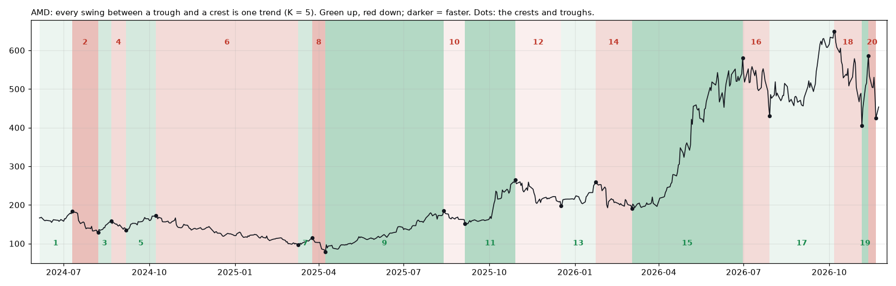
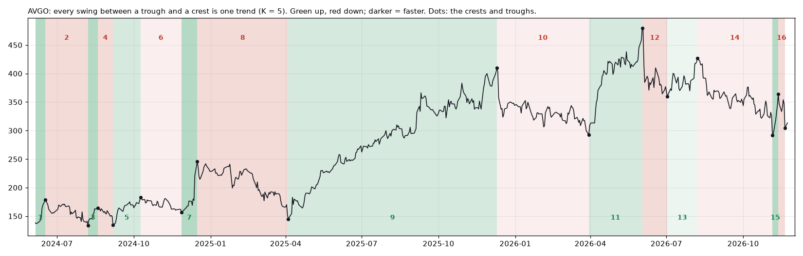
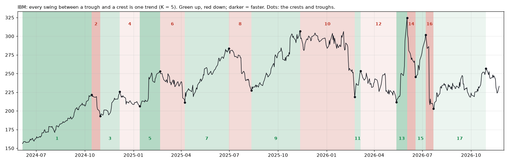
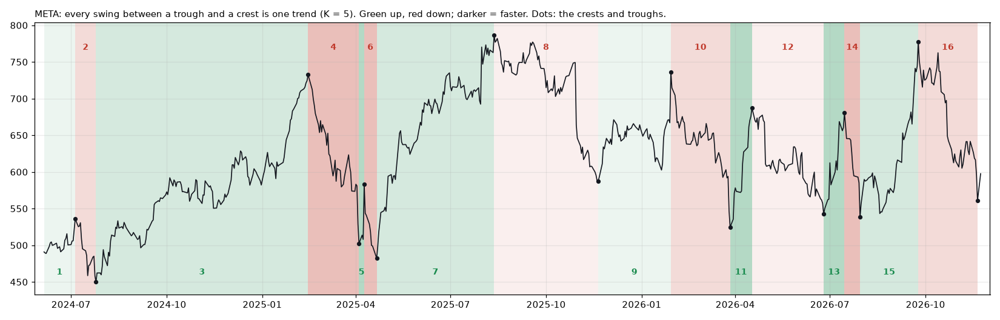
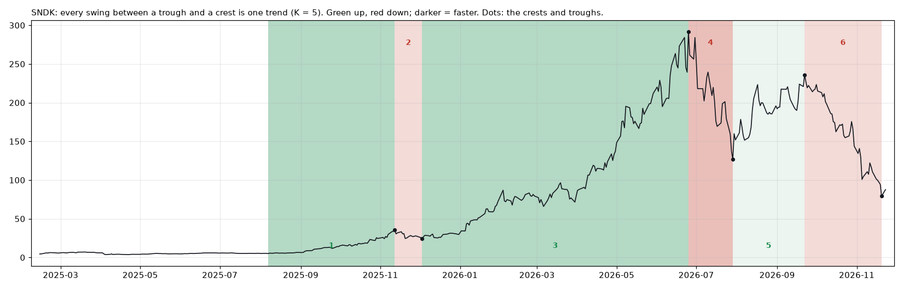

# The trends on the daily chart: every swing between a trough and a crest (third version, from the founder's marks)

Step 1 of the addition and subtraction pool (`docs/POOL_PLAN.md`). No news is used. A crest is marked when the price has fallen back from it by K usual daily moves of the stock, a trough the same way upward; a trend is the swing from one turn to the next. **K = 5**, the value that reproduces most of the founder's marks of 25 Nov (14 of 18): K=4: 12, K=5: 14, K=6: 13, K=7: 10, K=8: 8, K=9: 5, K=10: 5. 'Strength' = the move divided by how far the price drifts by chance in that many sessions (fast swings are darker); 'size' = the move in usual daily moves; 'first seen' = the day the swing could have been recognised with the prices known that day. The last swing of each stock is still running. **To mark: which numbers are wrong, and what is missing.**

## AAPL

| no. | direction | from | to | sessions | move | size, usual daily moves | strength (speed) | straightness | first seen |
|---|---|---|---|---|---|---|---|---|---|
| 1 | up | 2024-04-19 | 2024-07-16 | 59 | +43% | 29 | 3.7 (fast) | 0.48 | 2024-05-03 |
| 2 | down | 2024-07-16 | 2024-08-06 | 15 | -12% | 9 | 2.3 (medium) | 0.65 | 2024-07-24 |
| 3 | up | 2024-08-06 | 2024-12-26 | 99 | +25% | 16 | 1.6 (slow) | 0.26 | 2024-08-15 |
| 4 | down | 2024-12-26 | 2025-01-21 | 15 | -14% | 11 | 2.7 (fast) | 0.68 | 2025-01-10 |
| 5 | up | 2025-01-21 | 2025-02-24 | 23 | +11% | 7 | 1.5 (slow) | 0.40 | 2025-02-13 |
| 6 | down | 2025-02-24 | 2025-04-08 | 31 | -30% | 24 | 4.3 (fast) | 0.55 | 2025-03-10 |
| 7 | up | 2025-04-08 | 2025-12-02 | 164 | +67% | 29 | 2.2 (medium) | 0.26 | 2025-04-09 |
| 8 | down | 2025-12-02 | 2026-01-20 | 32 | -14% | 7 | 1.3 (slow) | 0.68 | 2026-01-15 |
| 9 | up | 2026-01-20 | 2026-02-06 | 13 | +13% | 6 | 1.7 (medium) | 0.83 | 2026-02-04 |
| 10 | down | 2026-02-06 | 2026-03-30 | 35 | -11% | 6 | 1.0 (slow) | 0.30 | 2026-03-13 |
| 11 | up | 2026-03-30 | 2026-06-02 | 44 | +28% | 12 | 1.9 (medium) | 0.48 | 2026-04-15 |
| 12 | down | 2026-06-02 | 2026-06-25 | 16 | -13% | 10 | 2.4 (medium) | 0.55 | 2026-06-09 |
| 13 | up | 2026-06-25 | 2026-07-28 | 22 | +24% | 14 | 3.1 (fast) | 0.62 | 2026-07-02 |
| 14 | down | 2026-07-28 | 2026-08-12 | 11 | -11% | 7 | 2.3 (medium) | 0.65 | 2026-07-31 |
| 15 | up | 2026-08-12 | 2026-11-13 (running) | 66 | +18% | 10 | 1.3 (slow) | 0.24 | 2026-09-03 |

## AMD

| no. | direction | from | to | sessions | move | size, usual daily moves | strength (speed) | straightness | first seen |
|---|---|---|---|---|---|---|---|---|---|
| 1 | up | 2024-05-01 | 2024-07-10 | 47 | +28% | 8 | 1.2 (slow) | 0.28 | 2024-05-28 |
| 2 | down | 2024-07-10 | 2024-08-07 | 20 | -30% | 12 | 2.8 (fast) | 0.64 | 2024-07-18 |
| 3 | up | 2024-08-07 | 2024-08-21 | 10 | +23% | 7 | 2.2 (medium) | 0.85 | 2024-08-19 |
| 4 | down | 2024-08-21 | 2024-09-06 | 11 | -15% | 5 | 1.6 (medium) | 0.52 | 2024-09-06 |
| 5 | up | 2024-09-06 | 2024-10-08 | 22 | +29% | 8 | 1.8 (medium) | 0.61 | 2024-09-19 |
| 6 | down | 2024-10-08 | 2025-03-10 | 103 | -44% | 19 | 1.9 (medium) | 0.28 | 2024-10-31 |
| 7 | up | 2025-03-10 | 2025-03-25 | 11 | +19% | 6 | 1.8 (medium) | 0.66 | 2025-03-24 |
| 8 | down | 2025-03-25 | 2025-04-08 | 10 | -32% | 13 | 4.2 (fast) | 0.99 | 2025-04-03 |
| 9 | up | 2025-04-08 | 2025-08-13 | 87 | +136% | 29 | 3.1 (fast) | 0.39 | 2025-04-09 |
| 10 | down | 2025-08-13 | 2025-09-05 | 16 | -18% | 6 | 1.5 (slow) | 0.64 | 2025-09-05 |
| 11 | up | 2025-09-05 | 2025-10-29 | 38 | +75% | 17 | 2.8 (fast) | 0.52 | 2025-10-06 |
| 12 | down | 2025-10-29 | 2025-12-17 | 34 | -25% | 8 | 1.4 (slow) | 0.30 | 2025-11-20 |
| 13 | up | 2025-12-17 | 2026-01-23 | 24 | +31% | 7 | 1.5 (slow) | 0.57 | 2026-01-21 |
| 14 | down | 2026-01-23 | 2026-03-03 | 26 | -26% | 8 | 1.6 (medium) | 0.37 | 2026-02-04 |
| 15 | up | 2026-03-03 | 2026-06-30 | 82 | +204% | 28 | 3.1 (fast) | 0.37 | 2026-04-09 |
| 16 | down | 2026-06-30 | 2026-07-29 | 20 | -26% | 7 | 1.6 (medium) | 0.35 | 2026-07-28 |
| 17 | up | 2026-07-29 | 2026-10-06 | 48 | +51% | 9 | 1.4 (slow) | 0.31 | 2026-09-17 |
| 18 | down | 2026-10-06 | 2026-11-05 | 22 | -38% | 11 | 2.3 (medium) | 0.49 | 2026-10-22 |
| 19 | up | 2026-11-05 | 2026-11-12 | 5 | +45% | 8 | 3.7 (fast) | 1.00 | 2026-11-10 |
| 20 | down | 2026-11-12 | 2026-11-20 (running) | 6 | -27% | 7 | 2.9 (fast) | 0.76 | 2026-11-20 |

## AMZN

| no. | direction | from | to | sessions | move | size, usual daily moves | strength (speed) | straightness | first seen |
|---|---|---|---|---|---|---|---|---|---|
| 1 | up | 2023-10-26 | 2024-07-02 | 170 | +67% | 22 | 1.7 (medium) | 0.25 | 2023-11-01 |
| 2 | down | 2024-07-02 | 2024-08-05 | 23 | -19% | 12 | 2.6 (medium) | 0.56 | 2024-07-19 |
| 3 | up | 2024-08-05 | 2025-02-04 | 125 | +50% | 23 | 2.0 (medium) | 0.24 | 2024-08-15 |
| 4 | down | 2025-02-04 | 2025-04-08 | 44 | -29% | 20 | 3.1 (fast) | 0.41 | 2025-02-21 |
| 5 | up | 2025-04-08 | 2025-04-09 | 1 | +12% | 6 | 5.8 (fast) | 1.00 | 2025-04-09 |
| 6 | down | 2025-04-09 | 2025-04-21 | 7 | -12% | 6 | 2.4 (medium) | 0.77 | 2025-04-21 |
| 7 | up | 2025-04-21 | 2025-09-09 | 97 | +42% | 17 | 1.7 (medium) | 0.27 | 2025-04-24 |
| 8 | down | 2025-09-09 | 2025-10-17 | 28 | -11% | 5 | 1.0 (slow) | 0.33 | 2025-10-17 |
| 9 | up | 2025-10-17 | 2025-11-03 | 11 | +19% | 8 | 2.5 (medium) | 0.63 | 2025-10-31 |
| 10 | down | 2025-11-03 | 2025-11-20 | 13 | -15% | 7 | 2.0 (medium) | 0.73 | 2025-11-18 |
| 11 | up | 2025-11-20 | 2026-01-09 | 33 | +14% | 6 | 1.0 (slow) | 0.37 | 2026-01-08 |
| 12 | down | 2026-01-09 | 2026-02-13 | 24 | -20% | 10 | 2.1 (medium) | 0.56 | 2026-02-06 |
| 13 | up | 2026-02-13 | 2026-05-06 | 56 | +38% | 15 | 2.0 (medium) | 0.39 | 2026-04-08 |
| 14 | down | 2026-05-06 | 2026-06-25 | 34 | -17% | 10 | 1.7 (medium) | 0.34 | 2026-06-03 |
| 15 | up | 2026-06-25 | 2026-07-15 | 13 | +12% | 6 | 1.6 (medium) | 0.71 | 2026-07-15 |
| 16 | down | 2026-07-15 | 2026-07-29 | 10 | -11% | 6 | 1.9 (medium) | 0.84 | 2026-07-29 |
| 17 | up | 2026-07-29 | 2026-08-03 | 3 | +25% | 11 | 6.5 (fast) | 1.00 | 2026-07-31 |
| 18 | down | 2026-08-03 | 2026-10-30 | 63 | -15% | 8 | 1.0 (slow) | 0.19 | 2026-09-01 |
| 19 | up | 2026-10-30 | 2026-11-10 (running) | 7 | +13% | 6 | 2.2 (medium) | 0.70 | 2026-11-10 |

## AVGO

| no. | direction | from | to | sessions | move | size, usual daily moves | strength (speed) | straightness | first seen |
|---|---|---|---|---|---|---|---|---|---|
| 1 | up | 2024-04-19 | 2024-06-17 | 40 | +52% | 18 | 2.9 (fast) | 0.49 | 2024-05-14 |
| 2 | down | 2024-06-17 | 2024-08-07 | 35 | -25% | 13 | 2.1 (medium) | 0.30 | 2024-06-24 |
| 3 | up | 2024-08-07 | 2024-08-19 | 8 | +23% | 8 | 2.8 (fast) | 0.98 | 2024-08-13 |
| 4 | down | 2024-08-19 | 2024-09-06 | 13 | -18% | 8 | 2.1 (medium) | 0.56 | 2024-09-06 |
| 5 | up | 2024-09-06 | 2024-10-09 | 23 | +36% | 11 | 2.3 (medium) | 0.59 | 2024-09-11 |
| 6 | down | 2024-10-09 | 2024-11-27 | 35 | -14% | 5 | 0.9 (slow) | 0.29 | 2024-11-27 |
| 7 | up | 2024-11-27 | 2024-12-16 | 12 | +57% | 16 | 4.5 (fast) | 0.79 | 2024-12-13 |
| 8 | down | 2024-12-16 | 2025-04-04 | 74 | -41% | 16 | 1.9 (medium) | 0.26 | 2025-01-27 |
| 9 | up | 2025-04-04 | 2025-12-10 | 172 | +183% | 28 | 2.1 (medium) | 0.30 | 2025-04-09 |
| 10 | down | 2025-12-10 | 2026-03-30 | 74 | -29% | 9 | 1.1 (slow) | 0.23 | 2025-12-15 |
| 11 | up | 2026-03-30 | 2026-06-02 | 44 | +64% | 17 | 2.5 (medium) | 0.51 | 2026-04-08 |
| 12 | down | 2026-06-02 | 2026-07-02 | 21 | -25% | 11 | 2.3 (medium) | 0.39 | 2026-06-05 |
| 13 | up | 2026-07-02 | 2026-08-07 | 25 | +19% | 6 | 1.2 (slow) | 0.32 | 2026-08-06 |
| 14 | down | 2026-08-07 | 2026-11-05 | 63 | -32% | 13 | 1.6 (slow) | 0.30 | 2026-08-19 |
| 15 | up | 2026-11-05 | 2026-11-12 | 5 | +25% | 7 | 3.3 (fast) | 1.00 | 2026-11-11 |
| 16 | down | 2026-11-12 | 2026-11-20 (running) | 6 | -16% | 6 | 2.4 (medium) | 0.60 | 2026-11-20 |

## CRWD

| no. | direction | from | to | sessions | move | size, usual daily moves | strength (speed) | straightness | first seen |
|---|---|---|---|---|---|---|---|---|---|
| 1 | up | 2024-06-04 | 2024-07-01 | 18 | +28% | 10 | 2.3 (medium) | 0.62 | 2024-06-07 |
| 2 | down | 2024-07-01 | 2024-08-02 | 23 | -44% | 22 | 4.6 (fast) | 0.81 | 2024-07-18 |
| 3 | up | 2024-08-02 | 2025-02-18 | 135 | +109% | 25 | 2.2 (medium) | 0.28 | 2024-08-14 |
| 4 | down | 2025-02-18 | 2025-03-10 | 14 | -32% | 13 | 3.5 (fast) | 0.70 | 2025-02-24 |
| 5 | up | 2025-03-10 | 2025-03-25 | 11 | +25% | 7 | 2.2 (medium) | 0.58 | 2025-03-17 |
| 6 | down | 2025-03-25 | 2025-04-04 | 8 | -16% | 6 | 2.1 (medium) | 0.63 | 2025-04-04 |
| 7 | up | 2025-04-04 | 2025-07-03 | 61 | +60% | 15 | 1.9 (medium) | 0.35 | 2025-04-15 |
| 8 | down | 2025-07-03 | 2025-09-04 | 43 | -20% | 7 | 1.0 (slow) | 0.34 | 2025-08-05 |
| 9 | up | 2025-09-04 | 2025-11-10 | 47 | +35% | 10 | 1.5 (slow) | 0.37 | 2025-09-18 |
| 10 | down | 2025-11-10 | 2026-02-24 | 71 | -37% | 16 | 1.9 (medium) | 0.32 | 2025-12-17 |
| 11 | up | 2026-02-24 | 2026-03-11 | 11 | +26% | 8 | 2.4 (medium) | 0.83 | 2026-03-04 |
| 12 | down | 2026-03-11 | 2026-03-27 | 12 | -16% | 6 | 1.8 (medium) | 0.61 | 2026-03-27 |
| 13 | up | 2026-03-27 | 2026-06-01 | 44 | +112% | 26 | 4.0 (fast) | 0.59 | 2026-04-08 |
| 14 | down | 2026-06-01 | 2026-06-09 | 6 | -18% | 7 | 2.8 (fast) | 1.00 | 2026-06-05 |
| 15 | up | 2026-06-09 | 2026-07-14 | 23 | +31% | 9 | 2.0 (medium) | 0.46 | 2026-06-30 |
| 16 | down | 2026-07-14 | 2026-07-29 | 11 | -15% | 5 | 1.6 (medium) | 0.90 | 2026-07-27 |
| 17 | up | 2026-07-29 | 2026-08-13 | 11 | +26% | 8 | 2.3 (medium) | 0.77 | 2026-08-04 |
| 18 | down | 2026-08-13 | 2026-08-25 | 8 | -18% | 6 | 2.3 (medium) | 0.92 | 2026-08-20 |
| 19 | up | 2026-08-25 | 2026-10-06 | 29 | +50% | 13 | 2.5 (medium) | 0.41 | 2026-08-27 |
| 20 | down | 2026-10-06 | 2026-11-23 (running) | 34 | -25% | 8 | 1.5 (slow) | 0.26 | 2026-10-16 |

## CSCO

| no. | direction | from | to | sessions | move | size, usual daily moves | strength (speed) | straightness | first seen |
|---|---|---|---|---|---|---|---|---|---|
| 1 | down | 2024-05-15 | 2024-06-13 | 20 | -8% | 7 | 1.6 (medium) | 0.50 | 2024-05-23 |
| 2 | up | 2024-06-13 | 2024-07-17 | 22 | +8% | 6 | 1.3 (slow) | 0.48 | 2024-07-17 |
| 3 | down | 2024-07-17 | 2024-08-05 | 13 | -8% | 7 | 1.9 (medium) | 0.48 | 2024-08-05 |
| 4 | up | 2024-08-05 | 2025-02-14 | 133 | +47% | 32 | 2.7 (fast) | 0.36 | 2024-08-15 |
| 5 | down | 2025-02-14 | 2025-04-08 | 36 | -17% | 17 | 2.8 (fast) | 0.45 | 2025-03-11 |
| 6 | up | 2025-04-08 | 2025-08-08 | 84 | +36% | 24 | 2.6 (medium) | 0.35 | 2025-04-09 |
| 7 | down | 2025-08-08 | 2025-08-15 | 5 | -8% | 6 | 2.5 (medium) | 0.80 | 2025-08-15 |
| 8 | up | 2025-08-15 | 2025-12-10 | 81 | +22% | 14 | 1.6 (slow) | 0.25 | 2025-10-20 |
| 9 | down | 2025-12-10 | 2026-01-20 | 26 | -8% | 6 | 1.1 (slow) | 0.37 | 2026-01-08 |
| 10 | up | 2026-01-20 | 2026-02-09 | 14 | +18% | 11 | 3.0 (fast) | 0.73 | 2026-02-02 |
| 11 | down | 2026-02-09 | 2026-02-12 | 3 | -14% | 10 | 5.5 (fast) | 1.00 | 2026-02-12 |
| 12 | up | 2026-02-12 | 2026-06-04 | 77 | +74% | 32 | 3.6 (fast) | 0.43 | 2026-03-26 |
| 13 | down | 2026-06-04 | 2026-07-16 | 28 | -15% | 9 | 1.7 (medium) | 0.28 | 2026-06-17 |
| 14 | up | 2026-07-16 | 2026-08-12 | 19 | +13% | 6 | 1.4 (slow) | 0.49 | 2026-08-04 |
| 15 | down | 2026-08-12 | 2026-11-20 (running) | 71 | -27% | 15 | 1.8 (medium) | 0.24 | 2026-08-19 |

## EMR

| no. | direction | from | to | sessions | move | size, usual daily moves | strength (speed) | straightness | first seen |
|---|---|---|---|---|---|---|---|---|---|
| 1 | down | 2024-05-09 | 2024-06-06 | 19 | -8% | 6 | 1.4 (slow) | 0.44 | 2024-06-04 |
| 2 | up | 2024-06-06 | 2024-07-16 | 26 | +12% | 8 | 1.7 (medium) | 0.39 | 2024-07-11 |
| 3 | down | 2024-07-16 | 2024-09-06 | 37 | -17% | 14 | 2.2 (medium) | 0.34 | 2024-08-02 |
| 4 | up | 2024-09-06 | 2024-12-04 | 62 | +37% | 20 | 2.6 (medium) | 0.48 | 2024-09-24 |
| 5 | down | 2024-12-04 | 2025-01-10 | 24 | -12% | 8 | 1.6 (medium) | 0.52 | 2024-12-18 |
| 6 | up | 2025-01-10 | 2025-01-23 | 8 | +11% | 6 | 2.3 (medium) | 1.00 | 2025-01-21 |
| 7 | down | 2025-01-23 | 2025-04-08 | 52 | -28% | 20 | 2.7 (fast) | 0.38 | 2025-02-24 |
| 8 | up | 2025-04-08 | 2025-07-25 | 74 | +60% | 25 | 3.0 (fast) | 0.48 | 2025-04-09 |
| 9 | down | 2025-07-25 | 2025-10-10 | 54 | -15% | 8 | 1.1 (slow) | 0.26 | 2025-08-06 |
| 10 | up | 2025-10-10 | 2025-11-03 | 16 | +11% | 5 | 1.4 (slow) | 0.64 | 2025-10-31 |
| 11 | down | 2025-11-03 | 2025-11-20 | 13 | -11% | 6 | 1.7 (medium) | 0.62 | 2025-11-18 |
| 12 | up | 2025-11-20 | 2026-02-10 | 54 | +31% | 14 | 1.9 (medium) | 0.34 | 2025-12-04 |
| 13 | down | 2026-02-10 | 2026-03-30 | 33 | -23% | 14 | 2.4 (medium) | 0.44 | 2026-02-12 |
| 14 | up | 2026-03-30 | 2026-05-06 | 26 | +20% | 9 | 1.7 (medium) | 0.38 | 2026-04-08 |
| 15 | down | 2026-05-06 | 2026-05-19 | 9 | -11% | 6 | 2.1 (medium) | 0.91 | 2026-05-15 |
| 16 | up | 2026-05-19 | 2026-06-18 | 21 | +15% | 8 | 1.7 (medium) | 0.42 | 2026-05-29 |
| 17 | down | 2026-06-18 | 2026-07-13 | 15 | -10% | 6 | 1.4 (slow) | 0.45 | 2026-07-08 |
| 18 | up | 2026-07-13 | 2026-08-11 | 21 | +21% | 10 | 2.1 (medium) | 0.50 | 2026-07-28 |
| 19 | down | 2026-08-11 | 2026-09-16 | 25 | -11% | 6 | 1.2 (slow) | 0.36 | 2026-09-01 |
| 20 | up | 2026-09-16 | 2026-10-29 | 31 | +17% | 8 | 1.4 (slow) | 0.47 | 2026-10-02 |
| 21 | down | 2026-10-29 | 2026-11-20 (running) | 16 | -11% | 6 | 1.5 (slow) | 0.39 | 2026-11-20 |

## GE

| no. | direction | from | to | sessions | move | size, usual daily moves | strength (speed) | straightness | first seen |
|---|---|---|---|---|---|---|---|---|---|
| 1 | down | 2024-05-08 | 2024-06-13 | 25 | -8% | 5 | 1.0 (slow) | 0.26 | 2024-06-13 |
| 2 | up | 2024-06-13 | 2024-10-21 | 89 | +25% | 14 | 1.5 (slow) | 0.19 | 2024-07-23 |
| 3 | down | 2024-10-21 | 2024-12-18 | 41 | -18% | 11 | 1.7 (medium) | 0.31 | 2024-10-22 |
| 4 | up | 2024-12-18 | 2025-03-25 | 64 | +33% | 15 | 1.9 (medium) | 0.34 | 2025-01-14 |
| 5 | down | 2025-03-25 | 2025-04-04 | 8 | -21% | 12 | 4.2 (fast) | 0.86 | 2025-04-03 |
| 6 | up | 2025-04-04 | 2025-10-29 | 143 | +89% | 30 | 2.5 (medium) | 0.36 | 2025-04-09 |
| 7 | down | 2025-10-29 | 2025-12-10 | 29 | -10% | 5 | 1.0 (slow) | 0.32 | 2025-12-05 |
| 8 | up | 2025-12-10 | 2026-01-06 | 17 | +16% | 8 | 1.8 (medium) | 0.56 | 2025-12-22 |
| 9 | down | 2026-01-06 | 2026-01-28 | 15 | -11% | 6 | 1.5 (slow) | 0.38 | 2026-01-22 |
| 10 | up | 2026-01-28 | 2026-03-02 | 22 | +18% | 8 | 1.8 (medium) | 0.57 | 2026-02-17 |
| 11 | down | 2026-03-02 | 2026-03-30 | 20 | -21% | 12 | 2.6 (fast) | 0.59 | 2026-03-12 |
| 12 | up | 2026-03-30 | 2026-04-14 | 10 | +16% | 7 | 2.3 (medium) | 0.58 | 2026-04-08 |
| 13 | down | 2026-04-14 | 2026-04-22 | 6 | -13% | 8 | 3.1 (fast) | 0.78 | 2026-04-21 |
| 14 | up | 2026-04-22 | 2026-07-06 | 50 | +37% | 17 | 2.4 (medium) | 0.39 | 2026-05-06 |
| 15 | down | 2026-07-06 | 2026-07-21 | 11 | -10% | 5 | 1.6 (medium) | 0.59 | 2026-07-20 |
| 16 | up | 2026-07-21 | 2026-08-05 | 11 | +12% | 6 | 1.7 (medium) | 0.61 | 2026-08-04 |
| 17 | down | 2026-08-05 | 2026-10-23 | 56 | -25% | 14 | 1.9 (medium) | 0.39 | 2026-08-24 |
| 18 | up | 2026-10-23 | 2026-11-11 (running) | 13 | +20% | 9 | 2.4 (medium) | 0.53 | 2026-11-03 |

## GOOG

| no. | direction | from | to | sessions | move | size, usual daily moves | strength (speed) | straightness | first seen |
|---|---|---|---|---|---|---|---|---|---|
| 1 | up | 2024-03-06 | 2024-07-10 | 86 | +46% | 21 | 2.3 (medium) | 0.37 | 2024-03-18 |
| 2 | down | 2024-07-10 | 2024-09-09 | 42 | -22% | 15 | 2.2 (medium) | 0.42 | 2024-07-24 |
| 3 | up | 2024-09-09 | 2024-11-12 | 46 | +23% | 11 | 1.7 (medium) | 0.43 | 2024-09-20 |
| 4 | down | 2024-11-12 | 2024-11-22 | 8 | -9% | 6 | 2.0 (medium) | 0.60 | 2024-11-22 |
| 5 | up | 2024-11-22 | 2025-02-04 | 47 | +25% | 13 | 1.9 (medium) | 0.33 | 2024-12-10 |
| 6 | down | 2025-02-04 | 2025-04-08 | 44 | -29% | 20 | 3.0 (fast) | 0.45 | 2025-02-07 |
| 7 | up | 2025-04-08 | 2026-02-02 | 205 | +136% | 46 | 3.2 (fast) | 0.31 | 2025-04-25 |
| 8 | down | 2026-02-02 | 2026-03-30 | 39 | -21% | 12 | 1.9 (medium) | 0.48 | 2026-02-11 |
| 9 | up | 2026-03-30 | 2026-05-13 | 31 | +46% | 20 | 3.7 (fast) | 0.70 | 2026-04-07 |
| 10 | down | 2026-05-13 | 2026-06-26 | 30 | -16% | 10 | 1.8 (medium) | 0.42 | 2026-06-02 |
| 11 | up | 2026-06-26 | 2026-07-15 | 12 | +11% | 6 | 1.6 (medium) | 0.53 | 2026-07-15 |
| 12 | down | 2026-07-15 | 2026-07-23 | 6 | -14% | 8 | 3.3 (fast) | 0.83 | 2026-07-23 |
| 13 | up | 2026-07-23 | 2026-08-04 | 8 | +18% | 8 | 3.0 (fast) | 0.93 | 2026-07-31 |
| 14 | down | 2026-08-04 | 2026-11-20 (running) | 77 | -30% | 18 | 2.0 (medium) | 0.33 | 2026-08-20 |

## IBM

| no. | direction | from | to | sessions | move | size, usual daily moves | strength (speed) | straightness | first seen |
|---|---|---|---|---|---|---|---|---|---|
| 1 | up | 2024-05-01 | 2024-10-14 | 114 | +46% | 29 | 2.7 (fast) | 0.40 | 2024-05-22 |
| 2 | down | 2024-10-14 | 2024-10-30 | 12 | -13% | 10 | 3.0 (fast) | 0.90 | 2024-10-24 |
| 3 | up | 2024-10-30 | 2024-12-06 | 26 | +17% | 11 | 2.2 (medium) | 0.60 | 2024-11-21 |
| 4 | down | 2024-12-06 | 2025-01-13 | 23 | -9% | 6 | 1.3 (slow) | 0.41 | 2024-12-18 |
| 5 | up | 2025-01-13 | 2025-02-20 | 26 | +23% | 14 | 2.7 (fast) | 0.57 | 2025-01-30 |
| 6 | down | 2025-02-20 | 2025-04-08 | 33 | -17% | 12 | 2.0 (medium) | 0.35 | 2025-03-20 |
| 7 | up | 2025-04-08 | 2025-06-30 | 56 | +34% | 18 | 2.3 (medium) | 0.39 | 2025-04-23 |
| 8 | down | 2025-06-30 | 2025-08-12 | 30 | -20% | 13 | 2.3 (medium) | 0.65 | 2025-07-24 |
| 9 | up | 2025-08-12 | 2025-11-12 | 65 | +35% | 17 | 2.1 (medium) | 0.36 | 2025-09-09 |
| 10 | down | 2025-11-12 | 2026-02-23 | 68 | -29% | 18 | 2.2 (medium) | 0.28 | 2026-02-11 |
| 11 | up | 2026-02-23 | 2026-03-06 | 9 | +16% | 7 | 2.3 (medium) | 0.87 | 2026-03-04 |
| 12 | down | 2026-03-06 | 2026-05-13 | 47 | -16% | 8 | 1.2 (slow) | 0.23 | 2026-04-10 |
| 13 | up | 2026-05-13 | 2026-06-02 | 13 | +53% | 20 | 5.6 (fast) | 0.94 | 2026-05-21 |
| 14 | down | 2026-06-02 | 2026-06-18 | 12 | -24% | 12 | 3.3 (fast) | 0.89 | 2026-06-05 |
| 15 | up | 2026-06-18 | 2026-07-07 | 11 | +23% | 8 | 2.5 (medium) | 0.80 | 2026-07-01 |
| 16 | down | 2026-07-07 | 2026-07-22 | 11 | -33% | 15 | 4.7 (fast) | 0.81 | 2026-07-14 |
| 17 | up | 2026-07-22 | 2026-10-29 (running) | 70 | +26% | 7 | 0.9 (slow) | 0.23 | 2026-09-09 |

## INTC

| no. | direction | from | to | sessions | move | size, usual daily moves | strength (speed) | straightness | first seen |
|---|---|---|---|---|---|---|---|---|---|
| 1 | up | 2024-05-10 | 2024-07-10 | 40 | +17% | 6 | 1.0 (slow) | 0.29 | 2024-07-08 |
| 2 | down | 2024-07-10 | 2024-09-06 | 41 | -45% | 25 | 4.0 (fast) | 0.40 | 2024-07-29 |
| 3 | up | 2024-09-06 | 2024-11-07 | 44 | +39% | 10 | 1.5 (slow) | 0.33 | 2024-09-23 |
| 4 | down | 2024-11-07 | 2024-12-19 | 29 | -27% | 9 | 1.8 (medium) | 0.49 | 2024-12-04 |
| 5 | up | 2024-12-19 | 2025-02-18 | 38 | +44% | 11 | 1.7 (medium) | 0.38 | 2025-02-13 |
| 6 | down | 2025-02-18 | 2025-03-11 | 15 | -28% | 9 | 2.4 (medium) | 0.72 | 2025-03-03 |
| 7 | up | 2025-03-11 | 2025-03-18 | 5 | +31% | 8 | 3.4 (fast) | 1.00 | 2025-03-14 |
| 8 | down | 2025-03-18 | 2025-04-08 | 15 | -30% | 10 | 2.5 (medium) | 0.81 | 2025-04-04 |
| 9 | up | 2025-04-08 | 2025-07-10 | 63 | +31% | 7 | 0.9 (slow) | 0.16 | 2025-05-13 |
| 10 | down | 2025-07-10 | 2025-08-01 | 16 | -19% | 5 | 1.3 (slow) | 0.75 | 2025-08-01 |
| 11 | up | 2025-08-01 | 2025-10-28 | 61 | +115% | 19 | 2.4 (medium) | 0.43 | 2025-08-14 |
| 12 | down | 2025-10-28 | 2025-11-20 | 17 | -19% | 5 | 1.3 (slow) | 0.54 | 2025-11-20 |
| 13 | up | 2025-11-20 | 2026-01-22 | 41 | +62% | 12 | 1.9 (medium) | 0.39 | 2025-12-02 |
| 14 | down | 2026-01-22 | 2026-03-30 | 46 | -24% | 7 | 1.0 (slow) | 0.18 | 2026-01-26 |
| 15 | up | 2026-03-30 | 2026-05-11 | 29 | +214% | 28 | 5.2 (fast) | 0.79 | 2026-04-06 |
| 16 | down | 2026-05-11 | 2026-06-05 | 18 | -23% | 6 | 1.4 (slow) | 0.43 | 2026-06-05 |
| 17 | up | 2026-06-05 | 2026-06-22 | 10 | +42% | 8 | 2.5 (medium) | 0.60 | 2026-06-12 |
| 18 | down | 2026-06-22 | 2026-07-29 | 26 | -42% | 12 | 2.3 (medium) | 0.49 | 2026-07-07 |
| 19 | up | 2026-07-29 | 2026-09-24 | 40 | +56% | 9 | 1.4 (slow) | 0.35 | 2026-08-13 |
| 20 | down | 2026-09-24 | 2026-11-20 (running) | 41 | -60% | 19 | 3.0 (fast) | 0.51 | 2026-10-14 |

## META

| no. | direction | from | to | sessions | move | size, usual daily moves | strength (speed) | straightness | first seen |
|---|---|---|---|---|---|---|---|---|---|
| 1 | up | 2024-04-30 | 2024-07-05 | 45 | +26% | 10 | 1.5 (slow) | 0.42 | 2024-05-15 |
| 2 | down | 2024-07-05 | 2024-07-25 | 14 | -16% | 8 | 2.1 (medium) | 0.57 | 2024-07-17 |
| 3 | up | 2024-07-25 | 2025-02-14 | 140 | +63% | 21 | 1.8 (medium) | 0.27 | 2024-08-08 |
| 4 | down | 2025-02-14 | 2025-04-04 | 34 | -31% | 20 | 3.4 (fast) | 0.46 | 2025-02-24 |
| 5 | up | 2025-04-04 | 2025-04-09 | 3 | +16% | 7 | 4.1 (fast) | 0.87 | 2025-04-09 |
| 6 | down | 2025-04-09 | 2025-04-21 | 7 | -17% | 8 | 3.1 (fast) | 1.00 | 2025-04-16 |
| 7 | up | 2025-04-21 | 2025-08-12 | 78 | +63% | 21 | 2.4 (medium) | 0.40 | 2025-04-25 |
| 8 | down | 2025-08-12 | 2025-11-20 | 71 | -25% | 13 | 1.5 (slow) | 0.34 | 2025-10-30 |
| 9 | up | 2025-11-20 | 2026-01-29 | 46 | +25% | 9 | 1.4 (slow) | 0.31 | 2025-12-05 |
| 10 | down | 2026-01-29 | 2026-03-27 | 40 | -29% | 14 | 2.2 (medium) | 0.50 | 2026-02-12 |
| 11 | up | 2026-03-27 | 2026-04-17 | 14 | +31% | 11 | 2.9 (fast) | 0.93 | 2026-04-08 |
| 12 | down | 2026-04-17 | 2026-06-25 | 47 | -21% | 11 | 1.5 (slow) | 0.31 | 2026-04-30 |
| 13 | up | 2026-06-25 | 2026-07-15 | 13 | +26% | 10 | 2.8 (fast) | 0.56 | 2026-07-01 |
| 14 | down | 2026-07-15 | 2026-07-30 | 11 | -21% | 10 | 2.9 (fast) | 1.00 | 2026-07-24 |
| 15 | up | 2026-07-30 | 2026-09-24 | 39 | +44% | 15 | 2.4 (medium) | 0.48 | 2026-09-03 |
| 16 | down | 2026-09-24 | 2026-11-20 (running) | 41 | -28% | 13 | 2.0 (medium) | 0.38 | 2026-10-22 |

## MSFT

| no. | direction | from | to | sessions | move | size, usual daily moves | strength (speed) | straightness | first seen |
|---|---|---|---|---|---|---|---|---|---|
| 1 | up | 2024-04-30 | 2024-07-05 | 45 | +20% | 14 | 2.1 (medium) | 0.50 | 2024-05-14 |
| 2 | down | 2024-07-05 | 2024-08-05 | 21 | -15% | 13 | 2.9 (fast) | 0.62 | 2024-07-19 |
| 3 | up | 2024-08-05 | 2024-09-19 | 32 | +11% | 8 | 1.5 (slow) | 0.36 | 2024-08-15 |
| 4 | down | 2024-09-19 | 2024-10-31 | 30 | -7% | 6 | 1.1 (slow) | 0.30 | 2024-10-07 |
| 5 | up | 2024-10-31 | 2024-12-17 | 32 | +12% | 9 | 1.6 (medium) | 0.41 | 2024-12-04 |
| 6 | down | 2024-12-17 | 2025-01-14 | 17 | -9% | 7 | 1.8 (medium) | 0.55 | 2024-12-30 |
| 7 | up | 2025-01-14 | 2025-01-28 | 9 | +8% | 6 | 1.9 (medium) | 0.53 | 2025-01-22 |
| 8 | down | 2025-01-28 | 2025-04-08 | 49 | -21% | 18 | 2.5 (medium) | 0.40 | 2025-01-30 |
| 9 | up | 2025-04-08 | 2025-04-09 | 1 | +10% | 7 | 6.9 (fast) | 1.00 | 2025-04-09 |
| 10 | down | 2025-04-09 | 2025-04-21 | 7 | -8% | 5 | 2.1 (medium) | 0.69 | 2025-04-21 |
| 11 | up | 2025-04-21 | 2025-10-28 | 132 | +51% | 27 | 2.3 (medium) | 0.39 | 2025-04-25 |
| 12 | down | 2025-10-28 | 2026-01-21 | 57 | -18% | 13 | 1.7 (medium) | 0.34 | 2025-11-06 |
| 13 | up | 2026-01-21 | 2026-01-28 | 5 | +8% | 5 | 2.4 (medium) | 1.00 | 2026-01-27 |
| 14 | down | 2026-01-28 | 2026-03-27 | 41 | -26% | 20 | 3.1 (fast) | 0.47 | 2026-01-29 |
| 15 | up | 2026-03-27 | 2026-06-01 | 44 | +29% | 16 | 2.3 (medium) | 0.40 | 2026-04-14 |
| 16 | down | 2026-06-01 | 2026-06-25 | 17 | -23% | 17 | 4.1 (fast) | 0.75 | 2026-06-05 |
| 17 | up | 2026-06-25 | 2026-11-04 | 92 | +58% | 27 | 2.8 (fast) | 0.33 | 2026-07-02 |
| 18 | down | 2026-11-04 | 2026-11-20 (running) | 12 | -13% | 6 | 1.9 (medium) | 0.65 | 2026-11-19 |

## MU

| no. | direction | from | to | sessions | move | size, usual daily moves | strength (speed) | straightness | first seen |
|---|---|---|---|---|---|---|---|---|---|
| 1 | up | 2024-04-19 | 2024-06-18 | 41 | +44% | 15 | 2.4 (medium) | 0.44 | 2024-05-10 |
| 2 | down | 2024-06-18 | 2024-08-07 | 34 | -43% | 24 | 4.2 (fast) | 0.56 | 2024-06-27 |
| 3 | up | 2024-08-07 | 2024-08-19 | 8 | +25% | 8 | 3.0 (fast) | 1.00 | 2024-08-14 |
| 4 | down | 2024-08-19 | 2024-09-09 | 14 | -21% | 9 | 2.3 (medium) | 0.81 | 2024-08-28 |
| 5 | up | 2024-09-09 | 2024-11-07 | 43 | +32% | 10 | 1.5 (slow) | 0.25 | 2024-09-26 |
| 6 | down | 2024-11-07 | 2024-12-31 | 36 | -26% | 10 | 1.7 (medium) | 0.31 | 2024-11-15 |
| 7 | up | 2024-12-31 | 2025-01-21 | 12 | +30% | 8 | 2.3 (medium) | 0.64 | 2025-01-07 |
| 8 | down | 2025-01-21 | 2025-01-28 | 5 | -19% | 6 | 2.9 (fast) | 1.00 | 2025-01-27 |
| 9 | up | 2025-01-28 | 2025-02-18 | 14 | +21% | 5 | 1.5 (slow) | 0.49 | 2025-02-18 |
| 10 | down | 2025-02-18 | 2025-04-04 | 33 | -39% | 14 | 2.5 (medium) | 0.40 | 2025-03-06 |
| 11 | up | 2025-04-04 | 2025-06-24 | 54 | +98% | 18 | 2.4 (medium) | 0.48 | 2025-04-25 |
| 12 | down | 2025-06-24 | 2025-08-01 | 27 | -18% | 5 | 0.9 (slow) | 0.41 | 2025-08-01 |
| 13 | up | 2025-08-01 | 2025-11-10 | 70 | +142% | 23 | 2.7 (fast) | 0.45 | 2025-08-12 |
| 14 | down | 2025-11-10 | 2025-11-20 | 8 | -21% | 6 | 2.1 (medium) | 0.67 | 2025-11-20 |
| 15 | up | 2025-11-20 | 2026-03-18 | 79 | +129% | 21 | 2.3 (medium) | 0.31 | 2025-12-08 |
| 16 | down | 2026-03-18 | 2026-03-30 | 8 | -30% | 9 | 3.2 (fast) | 0.97 | 2026-03-26 |
| 17 | up | 2026-03-30 | 2026-06-03 | 45 | +235% | 30 | 4.4 (fast) | 0.63 | 2026-04-08 |
| 18 | down | 2026-06-03 | 2026-06-05 | 2 | -20% | 5 | 3.8 (fast) | 1.00 | 2026-06-05 |
| 19 | up | 2026-06-05 | 2026-06-25 | 13 | +40% | 8 | 2.2 (medium) | 0.37 | 2026-06-15 |
| 20 | down | 2026-06-25 | 2026-07-29 | 23 | -39% | 11 | 2.2 (medium) | 0.45 | 2026-07-07 |
| 21 | up | 2026-07-29 | 2026-10-01 | 45 | +48% | 8 | 1.2 (slow) | 0.31 | 2026-08-14 |
| 22 | down | 2026-10-01 | 2026-11-20 (running) | 36 | -46% | 12 | 2.0 (medium) | 0.38 | 2026-11-02 |

## NVDA

| no. | direction | from | to | sessions | move | size, usual daily moves | strength (speed) | straightness | first seen |
|---|---|---|---|---|---|---|---|---|---|
| 1 | up | 2024-04-19 | 2024-06-18 | 41 | +78% | 19 | 3.0 (fast) | 0.56 | 2024-05-03 |
| 2 | down | 2024-06-18 | 2024-08-07 | 34 | -27% | 11 | 2.0 (medium) | 0.26 | 2024-07-24 |
| 3 | up | 2024-08-07 | 2024-08-19 | 8 | +31% | 9 | 3.1 (fast) | 0.98 | 2024-08-13 |
| 4 | down | 2024-08-19 | 2024-09-06 | 13 | -21% | 8 | 2.1 (medium) | 0.56 | 2024-09-03 |
| 5 | up | 2024-09-06 | 2025-01-06 | 83 | +45% | 12 | 1.3 (slow) | 0.22 | 2024-09-25 |
| 6 | down | 2025-01-06 | 2025-02-03 | 18 | -22% | 8 | 1.8 (medium) | 0.36 | 2025-01-27 |
| 7 | up | 2025-02-03 | 2025-02-20 | 12 | +20% | 5 | 1.5 (slow) | 0.82 | 2025-02-20 |
| 8 | down | 2025-02-20 | 2025-04-04 | 31 | -33% | 11 | 2.0 (medium) | 0.38 | 2025-03-03 |
| 9 | up | 2025-04-04 | 2025-10-29 | 143 | +120% | 22 | 1.8 (medium) | 0.31 | 2025-04-09 |
| 10 | down | 2025-10-29 | 2026-03-30 | 103 | -20% | 7 | 0.7 (slow) | 0.12 | 2025-12-12 |
| 11 | up | 2026-03-30 | 2026-05-14 | 32 | +43% | 14 | 2.5 (medium) | 0.59 | 2026-04-10 |
| 12 | down | 2026-05-14 | 2026-07-29 | 51 | -19% | 10 | 1.4 (slow) | 0.20 | 2026-05-29 |
| 13 | up | 2026-07-29 | 2026-10-06 | 48 | +26% | 10 | 1.5 (slow) | 0.28 | 2026-08-05 |
| 14 | down | 2026-10-06 | 2026-11-20 | 33 | -48% | 27 | 4.7 (fast) | 0.67 | 2026-10-22 |
| 15 | up | 2026-11-20 | 2026-11-23 (running) | 1 | +31% | 10 | 10.4 (fast) | 1.00 | 2026-11-23 |

## ORCL

| no. | direction | from | to | sessions | move | size, usual daily moves | strength (speed) | straightness | first seen |
|---|---|---|---|---|---|---|---|---|---|
| 1 | up | 2024-04-30 | 2024-07-12 | 50 | +28% | 12 | 1.7 (medium) | 0.38 | 2024-06-12 |
| 2 | down | 2024-07-12 | 2024-08-07 | 18 | -13% | 6 | 1.5 (slow) | 0.48 | 2024-08-05 |
| 3 | up | 2024-08-07 | 2024-11-21 | 75 | +53% | 19 | 2.2 (medium) | 0.44 | 2024-08-30 |
| 4 | down | 2024-11-21 | 2025-01-13 | 33 | -20% | 11 | 1.8 (medium) | 0.44 | 2024-12-13 |
| 5 | up | 2025-01-13 | 2025-01-23 | 7 | +21% | 10 | 3.6 (fast) | 1.00 | 2025-01-21 |
| 6 | down | 2025-01-23 | 2025-01-27 | 2 | -15% | 8 | 5.5 (fast) | 1.00 | 2025-01-27 |
| 7 | up | 2025-01-27 | 2025-02-19 | 16 | +15% | 6 | 1.5 (slow) | 0.51 | 2025-02-10 |
| 8 | down | 2025-02-19 | 2025-04-21 | 42 | -32% | 17 | 2.6 (medium) | 0.33 | 2025-03-04 |
| 9 | up | 2025-04-21 | 2025-09-10 | 98 | +168% | 38 | 3.8 (fast) | 0.48 | 2025-04-29 |
| 10 | down | 2025-09-10 | 2026-02-05 | 102 | -58% | 26 | 2.6 (medium) | 0.32 | 2025-10-22 |
| 11 | up | 2026-02-05 | 2026-06-01 | 79 | +82% | 17 | 1.9 (medium) | 0.27 | 2026-04-15 |
| 12 | down | 2026-06-01 | 2026-07-24 | 37 | -53% | 20 | 3.3 (fast) | 0.63 | 2026-06-10 |
| 13 | up | 2026-07-24 | 2026-09-08 | 31 | +41% | 9 | 1.6 (slow) | 0.39 | 2026-08-03 |
| 14 | down | 2026-09-08 | 2026-11-20 (running) | 53 | -38% | 11 | 1.6 (slow) | 0.27 | 2026-09-28 |

## QCOM

| no. | direction | from | to | sessions | move | size, usual daily moves | strength (speed) | straightness | first seen |
|---|---|---|---|---|---|---|---|---|---|
| 1 | up | 2024-04-19 | 2024-06-18 | 41 | +45% | 19 | 3.0 (fast) | 0.56 | 2024-05-02 |
| 2 | down | 2024-06-18 | 2024-08-07 | 34 | -31% | 20 | 3.4 (fast) | 0.40 | 2024-06-24 |
| 3 | up | 2024-08-07 | 2024-10-14 | 47 | +15% | 6 | 0.9 (slow) | 0.16 | 2024-08-30 |
| 4 | down | 2024-10-14 | 2024-12-19 | 47 | -15% | 7 | 1.0 (slow) | 0.22 | 2024-11-20 |
| 5 | up | 2024-12-19 | 2025-02-05 | 30 | +17% | 6 | 1.2 (slow) | 0.41 | 2025-01-22 |
| 6 | down | 2025-02-05 | 2025-04-08 | 43 | -29% | 14 | 2.2 (medium) | 0.41 | 2025-02-27 |
| 7 | up | 2025-04-08 | 2025-09-24 | 116 | +41% | 13 | 1.2 (slow) | 0.21 | 2025-04-09 |
| 8 | down | 2025-09-24 | 2025-10-10 | 12 | -12% | 5 | 1.5 (slow) | 0.62 | 2025-10-10 |
| 9 | up | 2025-10-10 | 2025-10-27 | 11 | +22% | 8 | 2.6 (medium) | 0.90 | 2025-10-27 |
| 10 | down | 2025-10-27 | 2025-11-20 | 18 | -15% | 7 | 1.6 (slow) | 0.45 | 2025-11-18 |
| 11 | up | 2025-11-20 | 2026-01-06 | 30 | +15% | 6 | 1.0 (slow) | 0.41 | 2025-12-10 |
| 12 | down | 2026-01-06 | 2026-04-07 | 62 | -32% | 16 | 2.0 (medium) | 0.43 | 2026-01-15 |
| 13 | up | 2026-04-07 | 2026-05-11 | 24 | +91% | 28 | 5.8 (fast) | 0.77 | 2026-04-20 |
| 14 | down | 2026-05-11 | 2026-05-19 | 6 | -18% | 8 | 3.2 (fast) | 0.76 | 2026-05-14 |
| 15 | up | 2026-05-19 | 2026-05-29 | 7 | +28% | 10 | 3.6 (fast) | 0.66 | 2026-05-22 |
| 16 | down | 2026-05-29 | 2026-06-10 | 8 | -24% | 10 | 3.4 (fast) | 0.58 | 2026-06-09 |
| 17 | up | 2026-06-10 | 2026-06-18 | 6 | +18% | 6 | 2.3 (medium) | 0.70 | 2026-06-18 |
| 18 | down | 2026-06-18 | 2026-07-31 | 29 | -35% | 14 | 2.6 (medium) | 0.52 | 2026-06-26 |
| 19 | up | 2026-07-31 | 2026-09-25 | 39 | +38% | 10 | 1.6 (slow) | 0.38 | 2026-09-08 |
| 20 | down | 2026-09-25 | 2026-11-20 (running) | 40 | -26% | 9 | 1.4 (slow) | 0.28 | 2026-10-30 |

## SNDK

| no. | direction | from | to | sessions | move | size, usual daily moves | strength (speed) | straightness | first seen |
|---|---|---|---|---|---|---|---|---|---|
| 1 | up | 2025-08-07 | 2025-11-12 | 68 | +596% | 36 | 4.4 (fast) | 0.57 | 2025-09-03 |
| 2 | down | 2025-11-12 | 2025-12-03 | 14 | -31% | 7 | 1.7 (medium) | 0.40 | 2025-11-20 |
| 3 | up | 2025-12-03 | 2026-06-25 | 139 | +1101% | 41 | 3.5 (fast) | 0.34 | 2026-01-02 |
| 4 | down | 2026-06-25 | 2026-07-29 | 23 | -56% | 13 | 2.7 (fast) | 0.46 | 2026-07-07 |
| 5 | up | 2026-07-29 | 2026-09-22 | 38 | +86% | 9 | 1.4 (slow) | 0.33 | 2026-08-13 |
| 6 | down | 2026-09-22 | 2026-11-20 (running) | 43 | -66% | 15 | 2.3 (medium) | 0.50 | 2026-10-16 |

## TSM

| no. | direction | from | to | sessions | move | size, usual daily moves | strength (speed) | straightness | first seen |
|---|---|---|---|---|---|---|---|---|---|
| 1 | up | 2024-04-19 | 2024-07-10 | 55 | +50% | 20 | 2.7 (fast) | 0.42 | 2024-05-03 |
| 2 | down | 2024-07-10 | 2024-08-05 | 18 | -23% | 13 | 3.0 (fast) | 0.49 | 2024-07-17 |
| 3 | up | 2024-08-05 | 2024-10-17 | 52 | +40% | 15 | 2.1 (medium) | 0.32 | 2024-08-09 |
| 4 | down | 2024-10-17 | 2024-11-27 | 29 | -12% | 5 | 1.0 (slow) | 0.27 | 2024-11-27 |
| 5 | up | 2024-11-27 | 2025-01-23 | 36 | +24% | 9 | 1.5 (slow) | 0.29 | 2024-12-23 |
| 6 | down | 2025-01-23 | 2025-04-08 | 52 | -37% | 18 | 2.5 (medium) | 0.36 | 2025-01-27 |
| 7 | up | 2025-04-08 | 2026-02-25 | 221 | +177% | 36 | 2.4 (medium) | 0.27 | 2025-04-24 |
| 8 | down | 2026-02-25 | 2026-03-30 | 23 | -18% | 8 | 1.7 (medium) | 0.40 | 2026-03-06 |
| 9 | up | 2026-03-30 | 2026-06-30 | 63 | +51% | 17 | 2.2 (medium) | 0.28 | 2026-04-08 |
| 10 | down | 2026-06-30 | 2026-07-29 | 20 | -22% | 10 | 2.2 (medium) | 0.52 | 2026-07-13 |
| 11 | up | 2026-07-29 | 2026-10-05 | 47 | +30% | 10 | 1.5 (slow) | 0.39 | 2026-08-12 |
| 12 | down | 2026-10-05 | 2026-11-05 | 23 | -27% | 13 | 2.6 (fast) | 0.56 | 2026-10-15 |
| 13 | up | 2026-11-05 | 2026-11-11 | 4 | +17% | 6 | 3.0 (fast) | 1.00 | 2026-11-11 |
| 14 | down | 2026-11-11 | 2026-11-20 (running) | 7 | -23% | 10 | 3.7 (fast) | 0.94 | 2026-11-17 |

## TXN

| no. | direction | from | to | sessions | move | size, usual daily moves | strength (speed) | straightness | first seen |
|---|---|---|---|---|---|---|---|---|---|
| 1 | up | 2024-04-19 | 2024-07-16 | 59 | +30% | 18 | 2.3 (medium) | 0.43 | 2024-04-24 |
| 2 | down | 2024-07-16 | 2024-08-05 | 14 | -12% | 9 | 2.3 (medium) | 0.42 | 2024-08-02 |
| 3 | up | 2024-08-05 | 2024-08-30 | 19 | +18% | 11 | 2.6 (medium) | 0.51 | 2024-08-13 |
| 4 | down | 2024-08-30 | 2024-10-22 | 36 | -10% | 6 | 1.1 (slow) | 0.19 | 2024-09-06 |
| 5 | up | 2024-10-22 | 2024-11-08 | 13 | +14% | 8 | 2.2 (medium) | 0.57 | 2024-10-29 |
| 6 | down | 2024-11-08 | 2025-01-29 | 53 | -18% | 12 | 1.6 (medium) | 0.28 | 2024-11-15 |
| 7 | up | 2025-01-29 | 2025-02-20 | 15 | +14% | 7 | 1.9 (medium) | 0.59 | 2025-02-19 |
| 8 | down | 2025-02-20 | 2025-04-08 | 33 | -28% | 18 | 3.1 (fast) | 0.51 | 2025-03-11 |
| 9 | up | 2025-04-08 | 2025-04-09 | 1 | +16% | 7 | 7.2 (fast) | 1.00 | 2025-04-09 |
| 10 | down | 2025-04-09 | 2025-04-21 | 7 | -14% | 7 | 2.5 (medium) | 0.67 | 2025-04-11 |
| 11 | up | 2025-04-21 | 2025-07-11 | 56 | +53% | 18 | 2.4 (medium) | 0.53 | 2025-05-02 |
| 12 | down | 2025-07-11 | 2025-08-01 | 15 | -18% | 8 | 2.0 (medium) | 0.73 | 2025-07-23 |
| 13 | up | 2025-08-01 | 2025-08-22 | 15 | +14% | 5 | 1.3 (slow) | 0.76 | 2025-08-22 |
| 14 | down | 2025-08-22 | 2025-11-20 | 63 | -25% | 11 | 1.4 (slow) | 0.35 | 2025-09-15 |
| 15 | up | 2025-11-20 | 2026-02-11 | 55 | +49% | 16 | 2.1 (medium) | 0.46 | 2025-12-02 |
| 16 | down | 2026-02-11 | 2026-03-30 | 32 | -18% | 8 | 1.3 (slow) | 0.44 | 2026-03-05 |
| 17 | up | 2026-03-30 | 2026-05-26 | 39 | +75% | 22 | 3.5 (fast) | 0.64 | 2026-04-09 |
| 18 | down | 2026-05-26 | 2026-06-10 | 11 | -13% | 6 | 1.8 (medium) | 0.50 | 2026-06-05 |
| 19 | up | 2026-06-10 | 2026-06-22 | 7 | +18% | 7 | 2.5 (medium) | 0.69 | 2026-06-18 |
| 20 | down | 2026-06-22 | 2026-09-01 | 50 | -23% | 10 | 1.5 (slow) | 0.24 | 2026-06-26 |
| 21 | up | 2026-09-01 | 2026-11-03 | 44 | +24% | 8 | 1.2 (slow) | 0.33 | 2026-10-02 |
| 22 | down | 2026-11-03 | 2026-11-20 (running) | 13 | -16% | 6 | 1.8 (medium) | 0.40 | 2026-11-20 |

## The founder's marks of 25 Nov, checked one by one

- AAPL down from about 2025-10-29 to about 2026-01-20: NOT found
- AAPL down from about 2026-02-06 to about 2026-03-30: found
- AAPL up from about 2026-08-12 to about 2026-11-13: found
- AAPL down from about 2026-07-28 to about 2026-08-12: found
- AAPL down from about 2024-12-26 to about 2025-04-08: NOT found
- NVDA down from about 2026-10-06 to about 2026-11-20: found
- NVDA up from about 2026-03-30 to about 2026-05-14: found
- NVDA down from about 2025-10-29: found
- TSM down from about 2024-10-17 to about 2024-11-27: found
- TSM up from about 2024-11-27 to about 2025-01-23: found
- TSM up from about 2026-03-30 to about 2026-06-30: found
- TSM down from about 2025-01-23 to about 2025-04-08: found
- TSM down from about 2026-10-05 to about 2026-11-20: NOT found
- AMD up from about 2026-03-03 to about 2026-06-30: found
- AMD down from about 2026-01-23 to about 2026-03-03: found
- AMD down from about 2026-06-30 to about 2026-07-29: found
- AMD up from about 2026-09-03 to about 2026-10-06: NOT found
- AMD down from about 2026-10-06 to about 2026-11-05: found
- first example, NVDA down 2026-10-06 to 2026-11-20: trend 14, 2026-10-06 to 2026-11-20, 33 sessions, -48%
- first example, AMD up 2026-04-04 to 2026-05-11: trend 15, 2026-03-03 to 2026-06-30, 82 sessions, +204%
